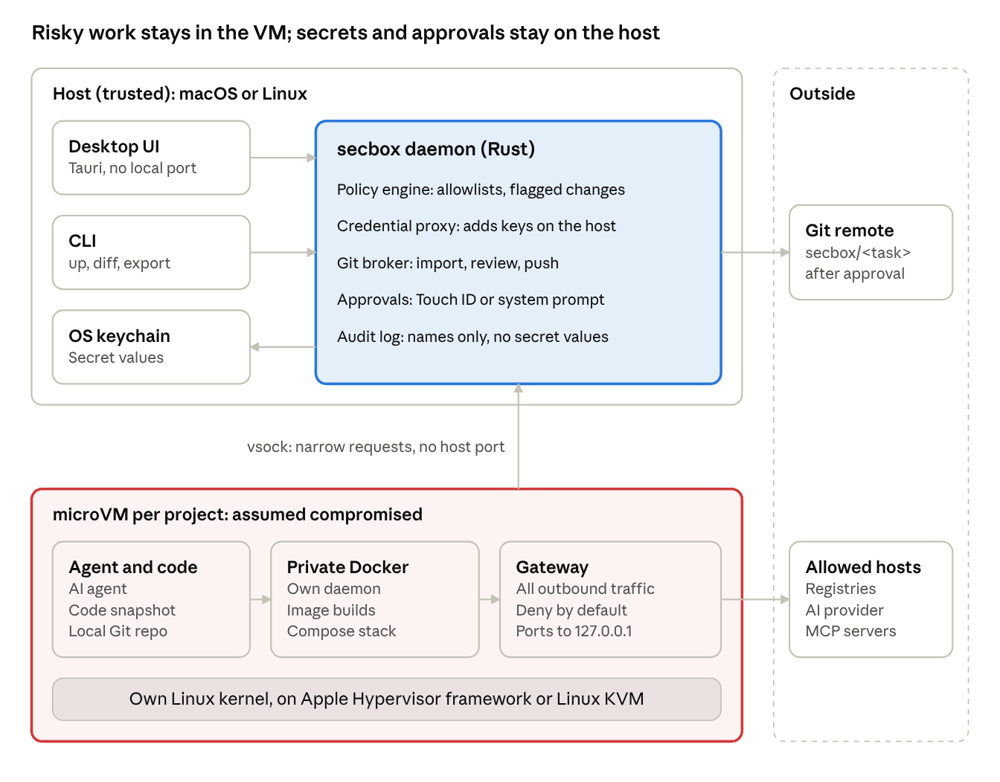
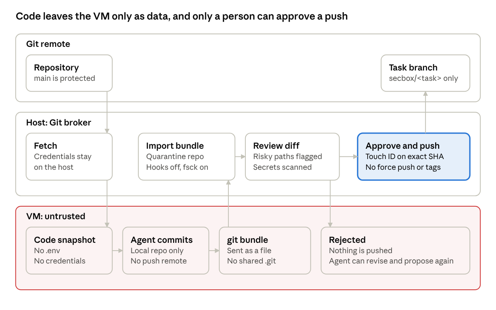
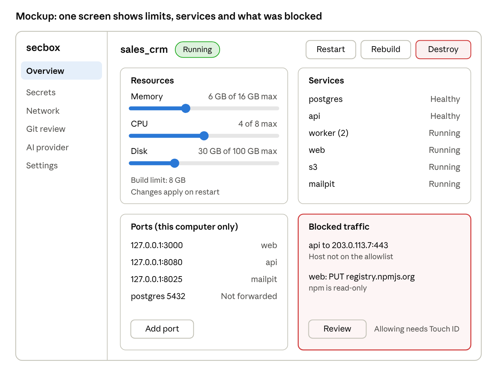
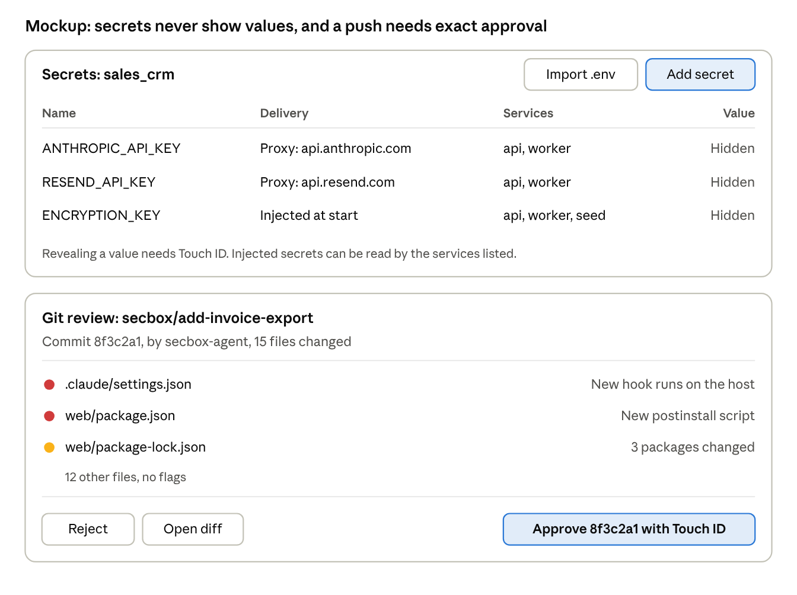

# secbox: Architecture and Security Design

As of Nov 5, 2026. Exported from the [hosted design doc](https://claude.ai/artifact/R7gQPbn5mzGaNnKknPt34Z). `secbox` is a working name, see "Changing the name" in the README.

## Summary

secbox runs a project and its AI agent inside a disposable microVM, so a compromised dependency or tricked agent stays away from the host.

The core decision is one small VM per project, with its own kernel and Docker daemon. Build steps, runtime traffic and Compose then sit behind one boundary, and most projects run unmodified.

The design assumes everything inside the VM is compromised. Secrets, policy, approvals and Git pushes stay on the host, and the VM can only make narrow requests for them.

**Status:** microsandbox ran `demo_shop` under Compose, and its allowlist held for nested traffic in testing. TLS interception breaks HTTPS in nested containers by default, so method rules and proxy-injected secrets aren't solved yet. See `docs/spikes/0001-engine-compose.md`.

## Why now

Recent npm attacks run at install time, steal developer credentials and use them to spread. A locked inbound port does nothing against that, so secbox has to control outbound traffic and what the code can reach.

| Date (2026) | Incident | What it means for secbox |
| --- | --- | --- |
| Aug 4 | [ChainDrop](https://www.microsoft.com/en-us/security/blog/2026/08/04/chaindrop-supply-chain-compromise-anatomy-self-propagating-worm/): more than 400 packages, spread by a preinstall hook and stolen publishing tokens | Provenance alone is not proof of safety, as packages can carry valid provenance |
| Aug 4 | Same report: stolen GitHub credentials inject `.claude/settings.json` and `.vscode/tasks.json` into repos | Files coming out of the sandbox need review |
| Jul 30 | [CVE-2026-58043](https://cvefeed.io/vuln/detail/CVE-2026-58043): Node.js Permission Model over-grants file access, CVSS 8.4, on 22.x, 24.x and 26.x | In-process permission flags are not a sufficient boundary |
| May 20 | [Mini Shai-Hulud](https://www.microsoft.com/en-us/security/blog/2026/05/20/mini-shai-hulud-compromised-antv-npm-packages-enable-ci-cd-credential-theft/): an @antv maintainer account compromised, targeting GitHub, AWS, Vault, npm, Kubernetes and 1Password credentials | Host credentials must never be reachable from project code |

Docker Desktop's own boundary has had gaps too. [Releases 4.68.0 and 4.71.0](https://docs.docker.com/desktop/release-notes/) addressed CVE-2026-5817 and CVE-2026-5843, both container-to-host code execution in Docker Model Runner.

## Existing tools

Of the tools checked, none combines an open-source laptop workflow with Compose, a secrets UI, reviewed rebuilds and bring-your-own AI. This was not an exhaustive market scan.

| Tool | License | Isolation | Compose | Main gap for this goal |
| --- | --- | --- | --- | --- |
| [Docker Sandboxes](https://www.docker.com/blog/why-microvms-the-architecture-be) | [Proprietary runtime](https://microsandbox.dev/compare/docker) | MicroVM per agent session, private Docker daemon | Yes, per Docker | Closed source and built around coding agents |
| [microsandbox](https://github.com/superradcompany/microsandbox) | Apache 2.0, beta | MicroVM with its own kernel, allowed-host network rules, secrets kept out of the VM | [Runs `dockerd` inside the VM](https://docs.microsandbox.dev/how-to/docker/docker-in-sandbox), Compose not documented | A runtime, not a full project workflow |
| [AerolVM](https://github.com/aerol-ai/microvm/) | MIT | Containers by default, Firecracker optional, per-sandbox egress control | Not confirmed | A sandbox platform aimed at Linux servers |

microsandbox is the first engine to test, because it may save building the VM and proxy layers. Docker Sandboxes is the benchmark to match on developer experience.

## Architecture

Each project gets a microVM with its own kernel and Docker daemon, while the host daemon keeps secrets, policy and Git credentials.



The VM can only send narrow requests to the daemon, and its network traffic must pass the gateway. A person approves anything that loosens policy or leaves through Git.

### What it runs on

A microVM uses the machine's own CPU through a hypervisor built into the OS, with a minimal Linux guest instead of a full desktop OS. Docker takes [the same general approach](https://www.docker.com/blog/why-microvms-the-architecture-be), using Apple's Hypervisor.framework and Linux KVM.

| Host | OS hypervisor | Requirement |
| --- | --- | --- |
| macOS | Hypervisor or Virtualization framework | Apple Silicon for microsandbox |
| Linux | KVM | `/dev/kvm`; cloud VMs need nested virtualization |

On Apple Silicon the guest runs arm64 Linux, so x86-only images need emulation, which is slower and can be unreliable.

### Stack

The daemon, CLI and desktop backend use Rust, which gives memory safety and a small binary with no runtime to install. Speed is a minor benefit, since VM boot and Docker builds dominate the wait.

Crates are a supply chain risk too, because `build.rs` runs at compile time. The project keeps dependencies few, commits `Cargo.lock`, and checks them in CI with `cargo-deny` and `cargo-vet`. The desktop front end stays small and pinned for the same reason.

## Security model

The host is trusted and everything in the VM is treated as compromised. Each control below limits what that compromise can reach, and none of them removes the risk completely.

| Threat | Control | What remains |
| --- | --- | --- |
| Malicious package at install or build | Runs inside the VM, with no host files or credentials | It can read anything placed in the VM |
| Data sent out | Deny-by-default egress, with allowlists by host and HTTP method | Leaks through an allowed host |
| Worm publishing to npm | npm allowed read-only, so publish requests are blocked | Other allowlisted write paths |
| Stolen API key | Proxy adds the key on the host, so the VM holds a placeholder | Misuse through the proxy while running |
| Files planted for the host | No shared folder; exports need review, with risky paths flagged | Malicious code you approve |
| Tricked AI agent | Agent runs in the VM and cannot change policy, read vault secrets or push | It can still damage the sandbox and propose bad code |
| VM or hypervisor escape | One VM per project, patched engine, small host interface | A zero-day could still reach the host |
| Attack on the secbox UI | No local web port, plain-text rendering, system approval prompts | Bugs in the desktop app or daemon |

The tool can't judge whether code is safe. It keeps a compromise contained until a person approves something leaving the sandbox.

**Browser path:** a sandboxed web app opened on the host runs its JavaScript in the host browser, outside the VM's network rules. It can make requests from there and send out what the user types into the page. A separate browser profile limits what it can reach.

### Seeing what happens

**Built today: blocked hostnames, and nothing else.** `secbox net blocked [-f]`, the Traffic panel and a count in `secbox status` show the name lookups the engine refused. The daemon reads them from a file the engine writes on the host, `<engine home>/sandboxes/<name>/logs/runtime.log`, and from its renamed copies.

Measured on engine 0.7.13:

| Fact | What follows |
| --- | --- |
| A refused lookup is logged at `--log-level debug`, and at the default level it is not | New sandboxes are created at debug. The level can't be changed later, but it survives a stop and start |
| Attempts to raw IPs, the metadata address and UDP were blocked and not logged, at debug or trace | The list is hostnames only, and every view says an empty list doesn't mean nothing was tried |
| The log grows by about 15 KB a second when idle, and renames at 10 MB to `.1` up to `.4`, deleting the oldest | About 50 MB is kept, or about an hour at best when idle. A guest making file activity pushed everything out in about 12 seconds, so views say when older events may be gone |
| The engine writes a name in DNS text form: a newline is `\012`, a space `\040` | Crafted names we sent could not fake a line or a field. The parser takes only the exact line, and counts a near match instead of using it |
| The guest's file shares are `guest-state` and a folder in `.bootstrap-rootfs`, both writable by it. `logs` is a sibling of those | As far as was measured, the guest cannot write this record. Crafted requests to the file share from a modified guest kernel were not tried |

The daemon decides whether a sandbox is recording from `log_level` in its own `sandbox.json`, written when it creates a sandbox. A sandbox with no recorded level counts as not recording, and the daemon never fills one in. To record, an older sandbox must be recreated with `secbox down --destroy`, then `secbox up`, which deletes its data.

The daemon checks each folder from the engine home down without following a link, and refuses a link, a pipe or a hard-linked file at the log. It reads at most 64 MB, and reads nothing under `guest-state`. If a folder on the way can be written by other accounts, every view says the record is not trustworthy.

The renamed log files are mode `0666`, set by the engine. Only the owner-only state folder above them keeps other accounts out.

The guest chooses every name it looks up, so a name shows what was asked for and proves nothing else.

**Still the design, not built:** a gateway that reports every network decision to the host daemon, so a compromised VM can't hide or edit that record. Query strings would be dropped, and secret values would never appear.

- **Blocked requests:** service, host, method and the rule responsible, including the raw IP and UDP attempts missing today. `secbox up` would also show a count.
- **All requests:** `secbox net log` would also show allowed requests, which is how misuse of an allowed host is spotted.
- **Inside the app:** blocked HTTP requests would get a clear error naming the blocked host and the command to review it, so a failure doesn't look like a random network bug.
- **Notifications:** an optional desktop notification would report new blocked hosts, grouped so it can't flood the user.
- **Allowing a host:** `secbox net allow` would show the exact rule and ask for system approval. An AI agent could only file a request, with `request_network`.

A blocked encrypted request would show only its host and port unless it passes through the intercepting proxy.

## Compose and non-Docker projects

Each project gets one VM, and its whole Compose stack runs on that VM's private daemon. Services still reach each other by name, but not other projects or the host.

**Compose files are untrusted.** The daemon inside the VM cannot see host paths, so a host mount, the host socket or `privileged` reaches only the VM. But the VM is where every service's secrets are delivered, so once a project has a secret assigned, any such setting is a blocker and the project will not start: one hostile service could otherwise read another's secrets from the VM's `tmpfs`, the Docker socket or `/proc`. Without secrets these stay findings. Published ports are forwarded to `127.0.0.1` on the host, and only when approved.

**Within a project, compromise can spread.** If `app` is compromised, it can attack `db` on the same network. Separate networks and narrowly assigned secrets reduce this.

### Test case: demo_shop

`demo_shop` is a useful first test: 7 default services, with `worker` running 2 replicas, plus Documenso as an optional profile. The API is Go and the web app is Next.js.

| Finding | Why it matters | secbox behavior |
| --- | --- | --- |
| `npm ci` runs in `web/Dockerfile`, with 638 locked npm packages | The dependency install happens during a build | Build inside the VM, with registry access only |
| Only 1 locked package has an install script (`unrs-resolver`) | Install-script risk is small today | Flag any new install script on rebuild |
| 7 ports published on all interfaces, including Postgres with `crm:crm` | Other devices on the network may reach them today | Forward only to `127.0.0.1` |
| `.env` at the repo root | Compose would load it automatically | Leave out of the snapshot |
| `seed`, `api` and `worker` share one environment block | One compromised service could see all of those secrets | Assign secrets per service |
| Fakes run when Airwallex and Documenso keys are absent | The stack should start with no real secrets | Default to no secrets |
| Three repo files bind-mounted read-only, one only with Documenso | These need to exist in the VM | Resolve them from the snapshot |
| Documenso and WebAuthn expect specific `localhost` addresses | Remapping ports could break sign-in and signing | Keep the same port numbers |

### Projects without Docker

secbox uses the first match in this order, and the user approves anything generated:

1. `docker-compose.yml` or `compose.yaml`
2. `Dockerfile`, run as a generated Compose file (below)
3. `devcontainer.json`
4. Manifests such as `package.json`, `go.mod` or `pyproject.toml`, mapped to a base image
5. An AI-drafted setup, if the project is still unclear

Work that needs macOS, such as Xcode builds, can't run in a Linux VM. secbox should refuse clearly rather than imply it is protected.

Today only the first two can be started. The rest are detected by `check` and refused by `up`.

**A Dockerfile-only project runs as Compose.** `projectcheck::dockerfile` reads the Dockerfile's `EXPOSE` lines and writes a Compose file with one service, `app`: `build: {context: ., dockerfile: Dockerfile}` and a port for each exposed TCP port, published on the same number inside the VM. Nothing else: no volumes, no privileges, no environment. The file is produced by serialising a fixed structure, so no text from the project goes into it; its only values are port numbers and a path detection fixed in advance. From then on it is a Compose project:

- The plan reads the generated text back with the same Compose checks, so its services, ports and build memory floor come from exactly what will run. The text is in the plan (`generated_compose`), so the digest and the approval cover it. The Dockerfile's own notes are the plan's findings.
- Ports go through the same planning and approval as a Compose project's. `EXPOSE` only offers a port; it is forwarded only if approved.
- The Dockerfile is hostile. It is read with a 1 MiB limit. Only the last build stage counts, heredoc bodies are skipped, and a non-backslash `escape` directive means no ports are offered. Anything that is not a plain number from 1 to 65535, optionally `/tcp`, is reported and left out: variables, ranges, UDP. At most 32 ports and 256 entries are read, and what is echoed is escaped and cut.
- The file is written as `compose.yaml` into the host's snapshot copy, in the daemon's staging folder, after the snapshot is taken and before it is copied in. Not onto the guest's `tmpfs`: `ps`, `stop`, `logs` and `exec` find their Compose file by name in `/work`, as they do for a Compose project. The staging copy is the daemon's own, so this never touches the engine's guest state. The file is created new, so a file or link already at that name is an error, and the start also refuses if the snapshot has any Compose or override file of its own, as a commit snapshot could. A project with an override file but no Compose file is blocked at planning.
- Once copied in, the guest can change the file, as it can a Compose project's own. That moves nothing the host relies on: ports and network rules are fixed on the sandbox at creation.

Ports a base image exposes are not in the Dockerfile and are not offered. Detection only looks for `Dockerfile` at the project root.

## Secrets and AI sign-in

Secret values live in macOS Keychain or Linux Secret Service, never in the repo or a plaintext secbox file. The daemon parses `.env` imports as data and never runs them through a shell. Values stay masked, and the audit log records names only.

Each secret is assigned to specific services and uses one delivery route:

| Type | Example | How it arrives | Remaining risk |
| --- | --- | --- | --- |
| API key | `ANTHROPIC_API_KEY` | VM holds a placeholder, proxy adds the real key for one bound host | Misuse through the proxy while running |
| App-read secret | `ENCRYPTION_KEY` | Injected at start into named services only | That service can steal it |
| Build secret | Private registry token | BuildKit secret, opt-in per build | The receiving build step can steal it |

Proxy injection means HTTPS interception, using a per-sandbox CA that only that VM trusts.

### AI sign-in

Login happens in the normal browser on the host, and the VM never needs one. The choice decides where the credential ends up:

| Method | Sign-in | Real credential lives | If the VM is compromised | v1 |
| --- | --- | --- | --- | --- |
| API key | `secbox ai login` | Host keychain | Key can't be read, but can be misused while running | Yes |
| Local model | None | Nowhere | No AI credential to steal | Yes |
| Subscription, in VM | `/login` or [`codex login --device-auth`](https://developers.openai.com/codex/auth) | Inside the VM | Token can be stolen until revoked | Yes, with a warning |
| Subscription, through proxy | Sign in through secbox on the host | Host, placeholder tokens in the VM | Same as API key | Later, after a terms check |

Docker's [`sbx/claude-kit` listing](https://hub.docker.com/r/sbx/claude-kit) describes the proxy pattern with sentinel tokens, though it also says the kit "does not load yet". Provider terms for this pattern have not been checked.

Codex device login is in beta and must be enabled in ChatGPT security settings first. OpenAI documents copying `~/.codex/auth.json` as a fallback but says to treat it like a password, so secbox should not automate that copy.

## MCP and prompt injection

No tool can guarantee an AI won't be influenced, because anything it reads can contain instructions. secbox assumes the agent can be tricked and limits what a tricked agent can do.

**Agents run inside the VM in v1.** A tricked agent then has only sandbox powers. An agent on the host may also have the user's shell and files, which secbox can't fully restrict, so host-side use is a clearly labeled weaker mode.

**Host agents connect through `secbox mcp serve`.** Built early, because the code is in the VM and an agent people already use on the host otherwise can't see it. `docs/MCP.md` has the details:

- **Transport:** stdio only. The agent starts the server as a child process, so there is no port for a local process or web page to reach.
- **Scope:** one project, fixed by `--project` at start. The server is one more daemon client, with the powers of `secbox logs`, `status` and `exec` and nothing else.
- **Tools:** `status`, `logs`, `exec`, `read_file` and `write_file`, all acting inside the VM. Each run goes through the daemon's `terminal` request, which refuses a sandbox that isn't running and writes an audit entry.
- **Host tools off:** `secbox mcp setup claude` makes a separate folder whose settings deny Claude Code's shell, file and web tools. Codex can't turn its shell off, so its setup is weaker: read-only, with commands put to the person first.
- **Not offered yet:** the tools that need approval, because the daemon can't ask a person yet.

| Capability | MCP tool | Who can do it |
| --- | --- | --- |
| Run commands, edit files, read logs | `exec`, `read_file`, `write_file`, `logs` | Agent, inside the VM |
| Rebuild the stack | `rebuild` | Agent, under the rebuild rules |
| Propose code for export | `propose_change` | Agent proposes, person approves |
| Ask for a new host | `request_network` | Agent asks, person approves |
| Read vault secrets | None | Daemon only, for delivery by the rules above |
| Change policy | None | Person, with a system prompt |
| Push to a remote | None | Git broker, after approval |

The VM reaches the host daemon over vsock, with no host port and a fixed set of narrow requests. Approval prompts come from the host OS, so nothing in the VM can click them.

**External MCP servers** are treated as outside services:

- Each server needs an allowlisted host and tool list, with credentials held by the proxy.
- Tool descriptions are pinned by hash, and a change needs new approval.
- `npx`-launched servers run sandboxed, since they are npm code too.
- Tool output is untrusted input to the agent. Labeling it helps, but the permission limits are what actually protect the host.

## Git

The VM holds no Git credentials, SSH agent or push remote, so the agent can commit but can't publish.

**Projects from a remote, with a Git relay:** `secbox up git@host:org/repo.git` needs no clone on the host. The VM gets a real clone with its full history, and still holds no credential. Its Git uses a relay script as its `ssh`, which hands the connection back to the daemon. The daemon runs the real `ssh` on the host, with the user's agent, to the project's own URL only. Before a push leaves, the daemon reads Git's branch list and refuses `main`, `master`, deletes and tags. Pull, push and any other Git command are requests (`secbox git`, the Changes tab, MCP `git`), not credentials, and run inside the VM, so a tricked agent can push a branch but can't reach `main` or another repository. The host never parses the VM's Git data beyond that list. `docs/GIT.md` has the details.



The host never mounts or runs Git inside a `.git` written by the sandbox. Hooks, `core.fsmonitor` and `core.sshCommand` could otherwise execute on the host.

**Flagged for extra review:** `.github/workflows`, `.vscode`, `.claude`, `CLAUDE.md`, `AGENTS.md`, `.gitmodules`, `.gitattributes`, package scripts, lockfiles, Dockerfiles, symlinks, binaries and likely secrets. [ChainDrop](https://www.microsoft.com/en-us/security/blog/2026/08/04/chaindrop-supply-chain-compromise-anatomy-self-propagating-worm/) injected files under the `.claude` and `.vscode` paths.

**Rules enforced outside secbox:** branch protection blocks direct pushes to `main`, and the token excludes workflow permissions. A broker bug then still can't bypass review.

**Commit identity:** commits are attributed to the agent, and the user's signing key stays out of the VM.

**Remaining risks:**

- Subtly malicious code that gets approved can still run later on the host or in CI.
- Importing Git data on the host is attack surface. Validating bundles in a throwaway VM first would reduce it.

## Rebuild

Every rebuild runs untrusted code again, so it follows the same steps each time:

1. Take a fresh snapshot from a chosen git commit, or explicitly include uncommitted changes.
2. Flag changes to the lockfile, Dockerfile, Compose file, install scripts and requested hosts.
3. Build with no runtime secrets and registry-only network access.
4. Re-check policy, start the new version, and keep the previous image for rollback.

| Action | Keeps build cache | Keeps data | Use it when |
| --- | --- | --- | --- |
| Restart | Yes | Yes | The code has not changed |
| Rebuild | Yes | Yes | Normal code or dependency changes |
| Clean rebuild | No | Yes | The cache may be stale or suspect |
| Reset data | Yes | No | The database or uploads need a fresh start |
| Destroy | No | No | A compromise is suspected, or the work is finished |

After a suspected compromise, use Destroy and rotate every secret that sandbox received. Build caches and data volumes can both carry a compromise.

## Mock designs

The CLI and desktop app are two clients of the same daemon, so neither has extra powers. All values below are samples, and the mockups are not final visual design.

### CLI

```text
$ secbox doctor
Hypervisor   ok
Free memory  ok
Suggested    6 GB memory, 4 CPUs, 30 GB disk

$ secbox up --memory 6G --cpus 4
Creating VM for demo_shop
Snapshot     commit 8f3c2a1, .env left out
Building     registry-only network, no runtime secrets
Ready        http://127.0.0.1:3000

$ secbox net blocked
This shows blocked hostnames only. Raw IP, metadata and UDP attempts are blocked but not recorded, so an empty list doesn't mean nothing was tried.

TIME (UTC)              COUNT  HOSTNAME
2026-11-05 08:36:39         2  telemetry.example.com

$ secbox diff
FLAG  .claude/settings.json  new hook runs on the host
FLAG  web/package.json       new postinstall script

$ secbox export --commit 8f3c2a1
Waiting for Touch ID...
```

Secrets are entered with `secbox secrets set NAME`, using a hidden prompt so values stay out of shell history. Scripts and agents can't approve their own requests. On a headless Linux server, approval uses a passphrase instead of Touch ID.

### Retro terminal UI (v2 idea)

Running the CLI with no arguments could open a full-screen, 1990s-style terminal UI, with menus and panels for projects, logs, secrets, blocked traffic and Git review. It would be one more client of the same daemon, so it gains no extra powers. It needs no web view or front-end toolchain, so it should be weighed against the Tauri app. All sandbox text it shows must be escaped.

### Desktop UI

The app talks to the daemon over an owner-only Unix socket and has no local web port. Browsers don't isolate cookies by port, so a compromised app on `localhost:3000` could otherwise target a UI on another local port. Logs, filenames and AI reports display as plain text.



The overview shows the RAM, CPU and disk limits next to the services using them. Blocked traffic has its own panel, so a failed request can be traced directly to the rule that stopped it.



The secrets screen shows where each secret goes, but not its value. The review screen puts files that could affect the host first, and the approve button names the exact commit.

## Debugging and editors

v1 has no SSH server in the VM. Debugging uses `secbox shell`, `secbox exec`, and `secbox logs` through the daemon, so the VM needs no open port or login keys.

Editors stay on the host and work on the user's normal checkout. Host changes reach the VM one way, through a new snapshot or sync, and VM changes return only through `diff` and `export`. Commands such as `npm install` go through `secbox exec`, because the VS Code terminal runs on the host.

VS Code Remote-SSH is not offered, because a compromised remote has been reported to reach a local terminal on the host.

`secbox open --sandbox` is the one editor connection into the VM. It starts VS Code in a separate profile with the extension in `apps/vscode`, on a virtual folder whose every read and write goes through `secbox editor-bridge`, and so through the daemon's `terminal` check. No project file is written to the host and no code from the VM runs there. This reverses an earlier decision not to ship an editor plug-in, because a person needs to read and edit what is in the sandbox. Tested on VS Code 1.142, a project's `.vscode/settings.json` served through a virtual folder is obeyed, including a terminal profile that runs a command on the host, and VS Code calls the folder trusted. So the bridge refuses `.vscode`, `.git` and `*.code-workspace` on the host side, and the profile offers no terminal but the sandbox's. Git in that window goes through the daemon.

`secbox check` verifies editor settings and project files, and `secbox open` runs that check before launching the editor:

- **Checks:** a list of named checks covers `task.allowAutomaticTasks`, Workspace Trust, `runOn: folderOpen` tasks, workspace settings that change these, and hooks such as those in `.claude/settings.json`.
- **Control:** the user turns each check on or off in a user-level file in the state folder. A repo can't change these choices, so a hostile `secbox.yaml` can't disable a check.
- **Overrides:** opening despite a failed check needs an explicit flag and is recorded in the audit log.
- **Fixes:** `secbox check --fix` changes user settings only with consent and keeps a backup. It does not change project files.
- **Limit:** opening a folder another way skips the gate, so this makes the safe path easier but is not a security boundary.

App, Docker and VM logs are written inside the VM and could be faked by a compromised VM. Blocked-traffic and audit logs are recorded by the host daemon. `logs` strips terminal control codes. Masking of known secret values is planned alongside secret delivery, and even then an encoded secret could slip through. An interactive shell must pass control codes through, so it can't have the same protection.

## RAM and CPU

Users set RAM, CPU and disk per project, and those limits are enforced on the VM. They protect the laptop as well, since a runaway build or crypto miner can only use its own allocation.

```yaml
# secbox.yaml (committed to the repo, no secret values)
resources:
  memory: 6G
  cpus: 4
  disk: 30G
  build:
    memory: 8G    # optional higher limit during builds
```

- **Defaults:** `secbox doctor` suggests a size from the project and the host's free memory. A local user setting can lower or raise it without editing the repo.
- **Repo values are requests:** a repo can't grant itself more than the user's maximum, so a hostile `secbox.yaml` can't take over the machine.
- **Host reserve:** secbox refuses to start if the total would leave too little for the host.
- **Per service:** Compose memory and CPU limits still apply inside the VM.
- **Changing a limit:** a person chooses limits in the app, kept on the host and shown in the plan. They reach a stopped sandbox through `msb modify` when it starts, with its data kept. msb 0.7.13 cannot change memory or CPUs on a running VM, and a disk can only grow.

### Minimum RAM

Measured for `demo_shop` on macOS with microsandbox 0.7.13, as recorded in `docs/spikes/0001-engine-compose.md`:

| Usage | Measured |
| --- | --- |
| Fresh VM with Docker | 159 MiB in the guest, 314 MiB on the host |
| `demo_shop` running | 0.6 to 0.7 GiB in the guest |
| `demo_shop` building, peak | 2.4 to 2.8 GiB in the guest |
| Smallest VM that built it | 3G succeeded; 2G failed every time |
| Host memory after a build | Stays near the full VM size, 4092 MiB on a 4G VM |

Budget the full VM size on the host, because memory isn't handed back after a build. The host guidance of 8 GB minimum and 16 GB recommended is still a judgment rather than a measurement.

## Open decisions

| Decision | Recommendation | Why |
| --- | --- | --- |
| One VM per project? | Yes | Builds and runtime share one boundary, at an estimated 1 GB overhead |
| Agents only inside the VM in v1? | Yes by default, with host agents through `secbox mcp serve` as a labeled weaker mode | A tricked agent in the VM gets only sandbox powers. A host agent also keeps whatever host tools its own settings leave on |
| API key plus in-VM subscription login in v1? | Yes, with a warning | Most developers expect to use a subscription |
| CLI first, desktop app next? | Yes | Proves the security core first, on the same daemon API |
| Tauri for the desktop app? | Yes | Needs no local port, and shares Rust with the daemon |
| Final name | Keep `secbox` for now | [An openSUSE package named `secbox`](https://build.opensuse.org/package/meta/security/secbox) already exists, so check before release |

## Sources

- [Microsoft: ChainDrop](https://www.microsoft.com/en-us/security/blog/2026/08/04/chaindrop-supply-chain-compromise-anatomy-self-propagating-worm/)
- [Microsoft: Mini Shai-Hulud](https://www.microsoft.com/en-us/security/blog/2026/05/20/mini-shai-hulud-compromised-antv-npm-packages-enable-ci-cd-credential-theft/)
- [CVE-2026-58043 on cvefeed](https://cvefeed.io/vuln/detail/CVE-2026-58043)
- [Docker Desktop release notes](https://docs.docker.com/desktop/release-notes/)
- [Docker: Why MicroVMs](https://www.docker.com/blog/why-microvms-the-architecture-be)
- [Docker Hub: `sbx/claude-kit`](https://hub.docker.com/r/sbx/claude-kit)
- [microsandbox repository](https://github.com/superradcompany/microsandbox), [comparison with Docker](https://microsandbox.dev/compare/docker) and [Docker guide](https://docs.microsandbox.dev/how-to/docker/docker-in-sandbox)
- [AerolVM](https://github.com/aerol-ai/microvm/)
- [OpenAI Codex authentication](https://developers.openai.com/codex/auth)
