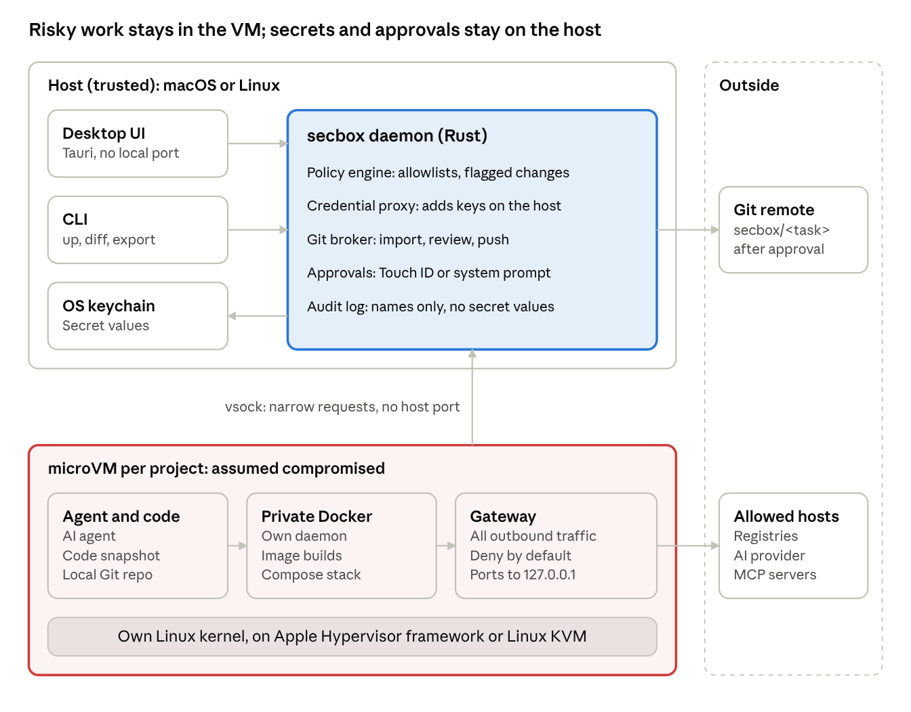

# How it works

secbox gives each project its own microVM and keeps everything worth stealing on the host. This page explains the parts and how a request travels between them.

## The parts

| Part | Where it runs | What it does |
| --- | --- | --- |
| `secbox` | Your machine | The command line tool, and a full-screen interface when run with no arguments. It decides nothing by itself: every action is a request to the daemon |
| `secboxd` | Your machine | The daemon. Holds the secrets, the policy and the approvals. Creates, starts, stops and destroys VMs through the engine |
| Engine (`msb`) | Your machine | [microsandbox](https://github.com/superradcompany/microsandbox), which boots the VMs using Apple's Hypervisor.framework or Linux KVM, and applies the hostname allowlist |
| Project VM | One per project | A small Linux VM with its own kernel and its own Docker daemon. Your Compose stack runs here |
| Desktop app | Your machine | A menu bar icon and a window. One more client of the daemon, with no powers of its own |

## Why a VM and not a container

A container shares your machine's kernel. A kernel bug, a mounted Docker socket or a `privileged: true` line can give a container your machine. A microVM has its own kernel, behind the hypervisor, so the same mistakes reach only the VM.

Each project gets a whole VM with its own Docker daemon, rather than one VM per container. Builds, runtime traffic and Compose then all sit behind one boundary, and most projects run unmodified. Services still reach each other by name, but not other projects or the host.

## What happens on `secbox up`

1. **Plan.** The CLI asks the daemon for a plan. The daemon reads the project's files as data, without running anything: the Compose file, `secbox.yaml`, which secrets are assigned, and the commit to start from. The plan has a digest, a fingerprint of exactly what was shown.
2. **Approve.** The CLI shows you the plan and asks which ports to forward. The approval it sends back carries the plan's digest. If anything changed since the plan was made, the daemon refuses.
3. **Snapshot.** The daemon exports the chosen Git commit, by default `HEAD`, and copies it into the VM at `/work`. Uncommitted changes are not included. Files whose names say they hold secrets never enter the snapshot: `.env` files, private keys, cloud and tool credentials, password stores, Terraform state and Git metadata. Example files such as `.env.example` are kept. The `.git` folder itself is not copied.
4. **Boot.** The engine creates the VM with the resource limits, the approved ports and the allowed hostnames, then starts Docker inside it.
5. **Build and start.** Docker Compose builds and starts the stack inside the VM. Secrets assigned to a service are delivered to that service only.
6. **Report.** The CLI prints each service's state and the forwarded addresses.

## How the CLI talks to the daemon

Over a Unix socket in the state folder (`~/.secbox/secboxd.sock`). The folder is readable only by you (`0700`) and so is the socket (`0600`), and the daemon checks the user ID of every connection. Nothing listens on a network port.

## How you get into a running VM

There is no SSH server and no open port in the VM. For `shell` and `exec`, the daemon checks that the sandbox is running and records the request, then tells the CLI where the engine is. The CLI runs the engine with a cleared environment, so none of your environment variables, API keys or tokens cross into the sandbox.

## What stays on the host

- **Secret values**, in the macOS Keychain or Linux Secret Service. secbox's own files hold names only.
- **Policy and approvals**, in the daemon.
- **Git credentials, SSH agent and push remotes.** None of them enter the VM.
- **Records of blocked traffic and an audit log**, written on the host, where the VM cannot edit them.

## What lives in the VM

- A copy of your project at `/work`.
- Docker images, build caches and data volumes.
- Secrets delivered to the services they are assigned to.
- Anything you type into `secbox shell`.

All of it is deleted by `secbox down --destroy`.

## Where to go next

- [Security model](security-model.md): what each control protects against, and what it does not.
- [Running a project](../guides/running-a-project.md): every option of `up` and `down`.
