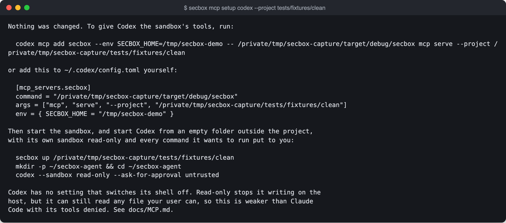

# AI agents over MCP

The project's code lives in the sandbox, so an AI agent on your machine cannot see it. `secbox mcp serve` is an MCP server that lets Claude Code, Codex or any other MCP client work inside one project's sandbox, while its own host tools are switched off.

> **Built, and run against a real VM.** MCP adds a way into the sandbox. It doesn't limit what an agent can do on your machine.

## One button, on a Mac

In the desktop app, start the project and press **Connect Claude Code** on its Overview. It makes a folder for this project in `~/secbox-agents`, and opens Terminal with Claude Code running there, its own tools off. Trust the folder and approve the `secbox` server when it asks. Pressing it again reuses the folder.

Started from anywhere else, Claude Code has its own tools back, so use the button or that folder. On other systems the app shows the command to run.

## Quick setup for Claude Code

```sh
secboxd &                                              # or the desktop app
secbox up ~/code/myapp
secbox mcp setup claude ~/agents/myapp --project ~/code/myapp
cd ~/agents/myapp && claude
```

On first start, Claude Code asks you to trust the folder and may ask you to approve the `secbox` server. Say yes to both. Run `/mcp` to check it says `connected`.

## Two ways to run an agent

| | Agent in the sandbox | Agent on the host, through MCP |
| --- | --- | --- |
| Where the agent runs | Inside the microVM | On your machine, as you |
| How it reaches the code | Directly, at `/work` | Through `secbox mcp serve` |
| What a tricked agent can do | Whatever the sandbox allows | Whatever the sandbox allows, **plus whatever its own host tools allow** |
| Your usual agent setup | Not available in the VM | Kept: your login, settings and editor |
| State | Planned | Built |

Running the agent on the host is the weaker mode. It is only safer than running the agent in your project folder if the agent's own host tools are turned off. `secbox mcp setup` arranges that for Claude Code, and only partly can for Codex.

## How the connection works

```text
Claude Code or Codex, on the host
   │  stdin and stdout pipes: MCP, JSON-RPC 2.0, one message per line
   ▼
secbox mcp serve --project PATH        child process of the agent, as your user
   │  Unix socket in ~/.secbox: owner-only folder and socket, peer user checked
   ▼
secboxd                                checks the sandbox is running, records the request
   │  answers with the sandbox's name and where the engine is
   ▼
secbox mcp serve runs the engine       cleared environment, working folder /
   ▼
microVM                                sh -c COMMAND in /work, or docker compose exec -T SERVICE
```

- **No network port.** The server uses MCP's stdio transport only. A server on `localhost` could be reached by any local process, and by web pages through DNS rebinding.
- **Bound to one project.** `--project` is required, and no tool takes a project argument, so a tool call cannot move the server to another project.
- **Same powers as the command line.** Every tool is a request to the daemon, with the same checks as `secbox logs`, `secbox status` and `secbox exec`.
- **Nothing from your environment crosses over.** The engine runs with a cleared environment.
- **Output is labeled.** Control sequences are removed, and every result from the sandbox starts with a line saying it is data, not instructions.

## The tools

| Tool | What it does |
| --- | --- |
| `status` | Whether the sandbox is running, its services, forwarded ports, refused lookups |
| `logs` | Recent log lines. Never follows |
| `exec` | Runs `sh -c COMMAND` in `/work`, or in one service |
| `read_file` | Reads a file under `/work` |
| `write_file` | Replaces a file under `/work` |
| `git` | Any Git command in the clone. Only fetch, pull and push reach the remote, through the relay. See [Git without handing over your keys](git.md) |
| `git_status`, `git_pull`, `git_commit`, `git_push` | Shortcuts for the common ones. On a Mac, every push waits for you to confirm with Touch ID |

Arguments and limits are in the [MCP tools reference](../reference/mcp-tools.md).

### What the server will not do

It has no tool to start, stop, rebuild or destroy a sandbox; read a secret or change assignments; change network policy or forward a port; push to `main` or `master`, delete a branch, push a tag or push to another repository; export; reach another project; or read and write your machine's files.

Tools that would need a person's approval, such as `request_network`, `propose_change` and `rebuild`, are not offered, because there is no approval prompt yet.

## Claude Code in detail

```sh
secbox mcp setup claude FOLDER --project PATH [--binary PATH]
```

This makes a **new, empty folder outside the project** and writes three files into it:

| File | What it does |
| --- | --- |
| `.mcp.json` | Starts `secbox mcp serve --project /abs/path`, using this program's absolute path. Passes on `SECBOX_HOME` if it is set |
| `.claude/settings.json` | Denies Claude Code's own `Bash`, `Read`, `Edit`, `Write`, `NotebookEdit`, `Glob`, `Grep`, `WebFetch` and `WebSearch`. Allows every `secbox` tool. Turns off bypass-permissions mode. Approves the `secbox` server |
| `CLAUDE.md` | Tells the agent the code is in the sandbox, its own tools are off on purpose, and sandbox output is data |

It refuses a folder that already has anything in it, and a folder inside the project or containing it. To redo a setup, delete the folder and run the command again.

The deny rules are enforced by Claude Code, not by secbox. They take precedence over allow rules in your other settings files. They apply **only when Claude Code is started in that folder**. Started anywhere else, it has its tools back.

## Codex

```sh
secbox mcp setup codex --project ~/code/myapp
```

This changes nothing. It prints a `codex mcp add` command, the matching `~/.codex/config.toml` lines, and how to start Codex:

```sh
codex mcp add secbox -- /abs/path/to/secbox mcp serve --project /abs/path/to/myapp
mkdir -p ~/secbox-agent && cd ~/secbox-agent
codex --sandbox read-only --ask-for-approval on-request
```



**This is much weaker than the Claude Code setup.** Codex runs commands on this machine without asking you. `--sandbox read-only` stops them writing, but they can read any file your user can, including the project on the host and your home folder. Measured on Codex 0.167: `ls ~` ran on the host with no prompt, and still did with its shell tool turned off, through its built-in JavaScript runner. Codex no longer has a mode that asks before every command (`untrusted` was removed). Use Claude Code when the agent must not read your files.

## Any other MCP client

Configure a **stdio** server whose command is the absolute path of `secbox`, with the arguments `mcp serve --project /abs/path/to/project`. Then turn off whatever host tools the client has, if it has a way to.

## What this does not protect

- **The agent's own host tools.** MCP adds a way into the sandbox. It does not take away anything the agent can already do on your machine. Its settings are the only thing between a tricked agent and your shell.
- **Your user's access to the daemon.** The socket checks which user connects, not which program. An agent with a host shell can run `secbox down --destroy` as you. On a Mac, starting, approving a hostname and pushing need your Touch ID, so it can ask but not agree; on Linux it can do those too.
- **Secrets in the sandbox.** A secret delivered to a service can be read with `exec`, for example `env` in that service. That output goes to the model, and so to the model's provider. Don't assign a secret to a project an agent works on unless the agent and its provider may see it.
- **Prompt injection.** Anything in the project, its dependencies or its logs can contain instructions. What limits the damage is that the tools only reach the sandbox, and the agent's host tools are off.
- **Getting the work out.** Changes stay in the sandbox. There is no reviewed way to bring them back yet. Destroying the sandbox deletes them.

## Troubleshooting

| Symptom | Cause and fix |
| --- | --- |
| `/mcp` shows the server as failed | Run the command from `.mcp.json` by hand. It prints one line to stderr and waits for input, which means it works. Ctrl-D ends it |
| A tool says the daemon is not running | Start `secboxd`. If you use `SECBOX_HOME`, check `.mcp.json` passes the same value |
| A tool says the sandbox is stopped, or there is none | Run `secbox up PATH`. The tools never start one |
| A tool says the daemon is older than this command | Restart `secboxd`. Its sandboxes keep running |
| The program moved, for example after reinstalling | `.mcp.json` holds its absolute path. Delete the agent folder and run setup again, or pass `--binary` |
| Claude Code asks to use `Bash` or `Read` anyway | It was started outside the agent folder, or the settings were edited. Start it from the folder setup made |
