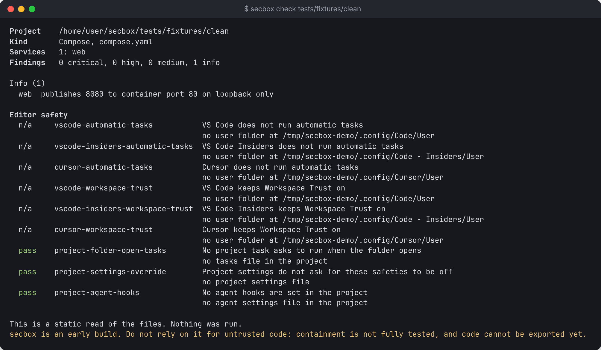
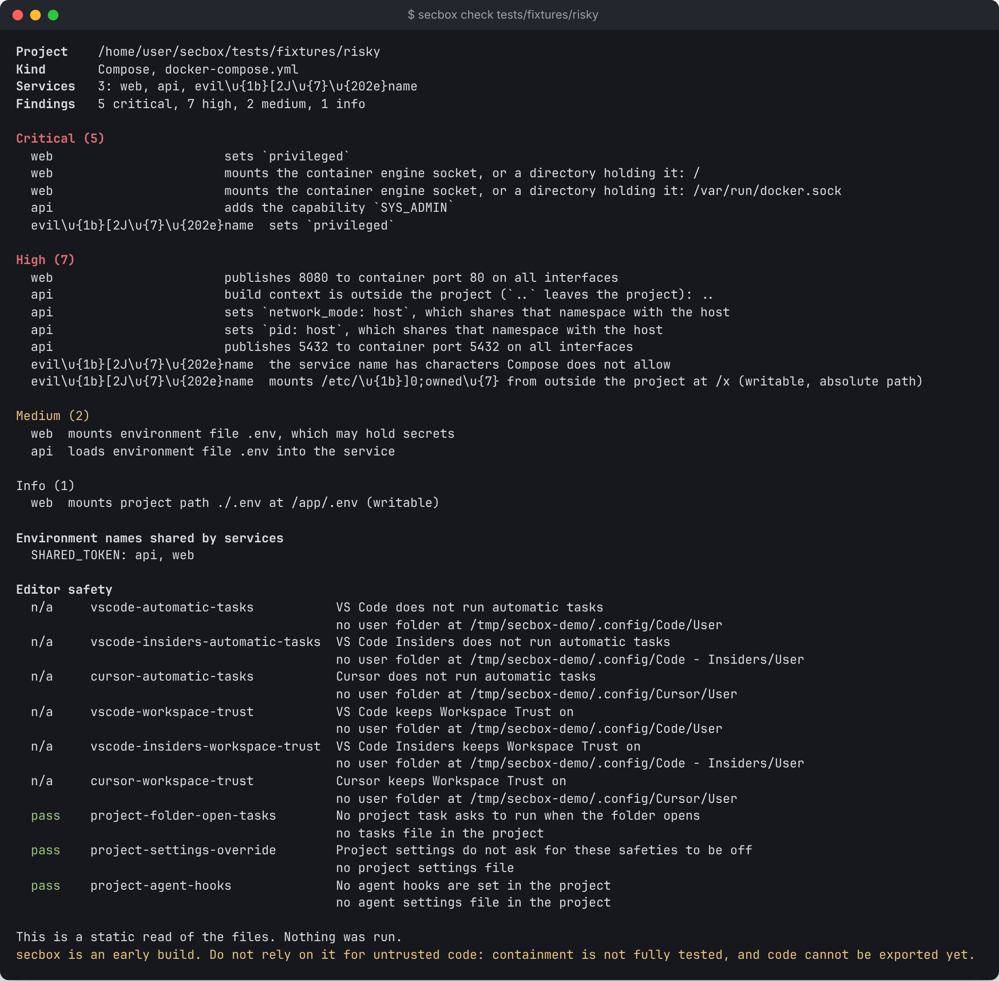

# Checking a project

`secbox check` reads a project's files and tells you what they ask for, before anything runs. It needs no VM and no daemon, and it never runs anything from the project.

```sh
secbox check            # the current folder
secbox check ~/code/myapp
```

## What it reads

| Project kind | What is read |
| --- | --- |
| Compose | `compose.yaml`, `compose.yml`, `docker-compose.yaml` or `docker-compose.yml` |
| Dockerfile only | The `EXPOSE` lines of the last build stage |
| Dev container, package manifest | Recognized and named, but `up` refuses them |

It also reads `secbox.yaml` if there is one, and runs the [editor safety checks](editors.md).

## Sample output



```text
Project    /home/you/code/clean
Kind       Compose, compose.yaml
Services   1: web
Findings   0 critical, 0 high, 0 medium, 1 info

Info (1)
  web  publishes 8080 to container port 80 on loopback only

Editor safety
  pass    project-folder-open-tasks  No project task asks to run when the folder opens
  pass    project-settings-override  Project settings do not ask for these safeties to be off
  pass    project-agent-hooks        No agent hooks are set in the project

This is a static read of the files. Nothing was run.
```

## Findings

Findings are grouped by severity: **Critical**, **High**, **Medium** and **Info**. They cover things such as:

- a port published on all interfaces, or on an interface that cannot be worked out, rather than loopback
- a mount of a path outside the project, of the container engine socket, or of an environment file
- `privileged`, added devices, disabled confinement (`security_opt`), or sharing the host's network, PID or other namespaces
- `env_file` entries, which load a file of variables into a service
- external networks and volumes, volume drivers that can bind a host path, and `host-gateway` names that point back at the machine
- a build that forwards an SSH agent or key, or asks for extra entitlements
- anything from a remote source, such as a remote `include`
- a setting that comes from a variable, which could change it to something above

Variables matter because the file you read is not always the file that runs. A port written as `${HOST_IP}:8080:80` is reported as reachable on all interfaces, because a variable could make it so.

The editor safety checks are listed separately, under **Editor safety**.

## Options

| Option | What it does |
| --- | --- |
| `--strict` | Exit with code 3 if there are Critical or High findings, or the project kind is not supported. Useful in CI |
| `--fix` | Offer to change **your user** editor settings that failed a check. It asks first and keeps a backup. It never changes project files |

## In CI

```sh
secbox check --strict . || exit 1
```

Exit code 0 means no Critical or High findings. Exit code 3 means there were some.

## A risky project



## Hostile names

Every name that came from the project is shown with control characters escaped. A service named with a terminal escape sequence appears as visible text, for example:

```text
Services   3: web, api, evil\u{1b}[2J\u{7}\u{202e}name
```

Color is used only on a terminal, and is off when `NO_COLOR` is set or `TERM=dumb`.
