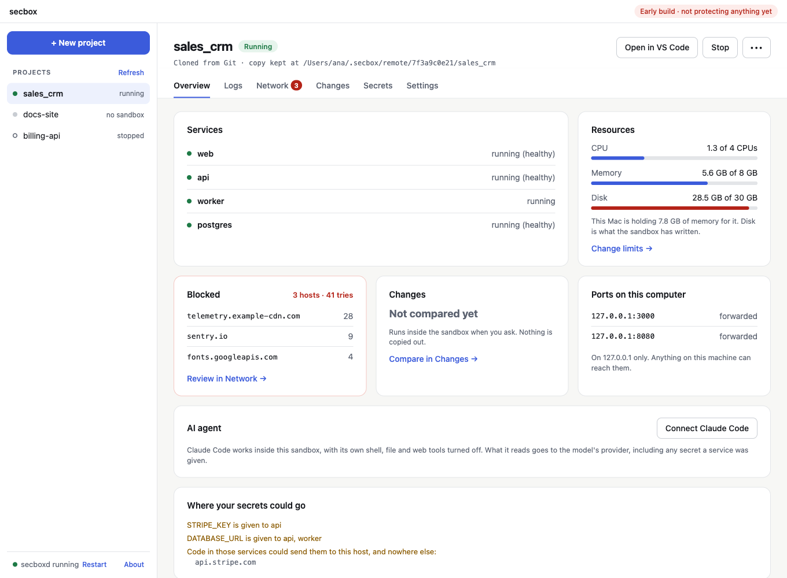

# Desktop app

The desktop app is a menu bar icon and a window for the same daemon the command line uses. It keeps `secboxd` running and lets you start, stop and destroy sandboxes, read logs and see blocked hostnames.

> **Early build.** It runs on a Mac when built from source. There is no signed release yet.

## What it has

**A menu bar icon** (a tray icon on Linux). It shows whether the daemon is answering and lists known projects with their state, with *Open window*, *Start daemon* or *Restart daemon*, and *Quit*. Closing the window keeps the app in the menu bar. Quitting the app leaves the daemon running.

**A window** with:

- an overview of each project: state, services, ports on `127.0.0.1`, the blocked-traffic count, and the CPU, memory and disk it is using. See [RAM, CPU and disk](resources.md#seeing-what-it-uses).
- a **Settings** tab that sets a project's memory, CPU and disk limits. See [RAM, CPU and disk](resources.md#changing-limits-in-the-app).
- *Start*, *Stop* and *Destroy*
- a **Logs** tab, and a **Network** tab with the blocked hostnames and what was refused for that project: pushes, starts that were not confirmed, and other refused requests
- a **Problems** page, below the project list and on the first screen, with everything refused or failed recently, newest first. It includes a fetch that failed and never became a project. It reads the daemon's audit log, so it lists refusals whoever asked: the command line, the app or an AI agent
- a **Terminal & about** tab, with commands to put the bundled CLI on your `PATH`
- a **Changes** tab that compares by itself and shows each file's changes side by side, the same comparison as [`secbox diff --patch`](reviewing-changes.md)

- an **Open in VS Code** button for a running project, which edits the sandbox's files with nothing copied to your machine. See [Editors](editors.md#editing-inside-the-sandbox).
- a **Secrets** tab that lists the project's secret names, stored and empty, and lets you set or replace a value and choose which services get it. See [Secrets](secrets.md#from-the-desktop-app).



## How it starts a project

*Start* asks the daemon for the plan and shows it: services, commit, ports to forward, allowed hosts, secret names, limits and findings. The project starts only after you click *Start with this plan*, and the request carries that plan's digest and ports. Cancel has the focus, so pressing Enter never agrees by accident.

On a Mac, the daemon then asks you to confirm with Touch ID or your password. The start page shows *Waiting for you to confirm in the system prompt* until you answer; the window can't answer it. **Approve** on a blocked hostname and **Push** on Changes ask the same way. On Linux there is no prompt, and the start page says *Started on this window's request alone*. See [Confirming with Touch ID](../concepts/confirming.md).

*Destroy* asks for its own confirmation, and afterwards tells you to rotate every secret the sandbox was given.

## The daemon

If nothing answers on the socket when the app opens, it starts `secboxd` and says so in the window. It looks beside its own executable first, where the bundled copy is, then on your `PATH`. The daemon runs in its own process group and outlives the app. Its output goes to `secboxd.log` in the app's log folder.

*Restart daemon* stops the daemon listening on the socket and starts it again. Sandboxes are separate processes and keep running.

## Security choices

- **No local web port.** The page is served by the app itself, with no dev server.
- **No front-end toolchain.** Plain HTML, CSS and JavaScript, with no npm packages.
- **A strict content security policy.** No inline script or style, nothing remote.
- **Plain text only.** Everything from the daemon or a sandbox is shown as text, never as HTML.
- **A short list of commands.** The window can call only the app's own commands, and has no file system, shell or HTTP access.
- **No powers of its own.** Every button is one request to the daemon, the same request the CLI sends.

## Build it

You need Rust and, on Linux, WebKitGTK:

```sh
sudo apt install libwebkit2gtk-4.1-dev libayatana-appindicator3-dev librsvg2-dev build-essential pkg-config libdbus-1-dev
cargo install tauri-cli --version '^2' --locked
```

On macOS, Xcode's command line tools are enough.

```sh
apps/desktop/scripts/prepare-sidecars.sh --debug   # builds secbox and secboxd for the bundle
cd apps/desktop/src-tauri
cargo tauri dev
```

`cargo tauri build` makes a `.app` and `.dmg` on macOS, and a `.deb` and `.AppImage` on Linux. See [`apps/desktop/README.md`](https://github.com/ketanmujumdar/secbox/blob/main/apps/desktop/README.md) for details.

## Using the bundled CLI

On macOS the app contains the CLI. Link it once:

```sh
sudo ln -sf /Applications/secbox.app/Contents/MacOS/secbox /usr/local/bin/secbox
# or, without admin rights, if ~/.local/bin is on your PATH:
mkdir -p ~/.local/bin && ln -sf /Applications/secbox.app/Contents/MacOS/secbox ~/.local/bin/secbox
```

On Linux the `.deb` installs `secbox`, `secboxd` and `secbox-desktop` into `/usr/bin`.

## Trying it safely

Set `SECBOX_HOME` to an empty folder before you open the app. The app and the daemon it starts then use `$SECBOX_HOME/.secbox`.
