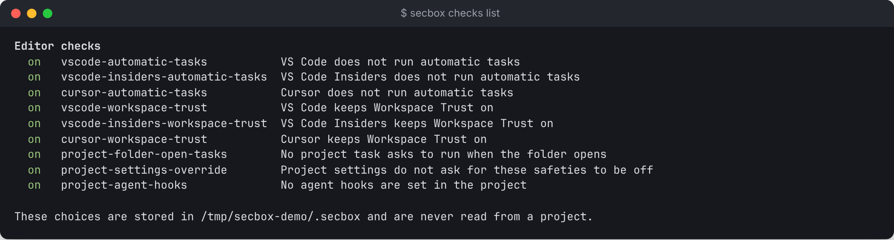

# Editors

Your editor runs on your machine and works on your normal checkout. A hostile project can try to run code the moment you open it in an editor, through automatic tasks or agent hooks. `secbox open` checks for that first, then opens the folder.

```sh
secbox open                    # check, then open the current folder in VS Code
secbox open ~/code/myapp --editor cursor
secbox open --dry-run          # check and say what would start
```

`secbox open` on its own opens your checkout, not the sandbox's files. To edit what is in the sandbox, see [below](#editing-inside-the-sandbox).

## Supported editors

| `--editor` | Program it starts |
| --- | --- |
| `vscode` (default) | `code` |
| `vscode-insiders` | `code-insiders` |
| `cursor` | `cursor` |

The program is found on your `PATH`, ignoring relative entries. If it is somewhere else, set `SECBOX_EDITOR_BIN` to its absolute path. A project cannot set this. The folder is passed as one argument, with no shell, so nothing in a folder name is ever interpreted.

## The checks

```sh
secbox checks list
```

```text
Editor checks
  on   vscode-automatic-tasks           VS Code does not run automatic tasks
  on   vscode-insiders-automatic-tasks  VS Code Insiders does not run automatic tasks
  on   cursor-automatic-tasks           Cursor does not run automatic tasks
  on   vscode-workspace-trust           VS Code keeps Workspace Trust on
  on   vscode-insiders-workspace-trust  VS Code Insiders keeps Workspace Trust on
  on   cursor-workspace-trust           Cursor keeps Workspace Trust on
  on   project-folder-open-tasks        No project task asks to run when the folder opens
  on   project-settings-override        Project settings do not ask for these safeties to be off
  on   project-agent-hooks              No agent hooks are set in the project
```



| Check | What it looks at |
| --- | --- |
| `*-automatic-tasks` | Your user setting `task.allowAutomaticTasks` |
| `*-workspace-trust` | Your user setting that keeps Workspace Trust on |
| `project-folder-open-tasks` | Tasks in the project with `runOn: folderOpen` |
| `project-settings-override` | Project settings that try to turn these safeties off |
| `project-agent-hooks` | Hooks in coding-agent settings, such as `.claude/settings.json` |

Each result is `pass`, `fail` or `n/a` (for example, when that editor is not installed). The same checks run as part of `secbox check`.

## Turning a check off or on

```sh
secbox checks off cursor-workspace-trust
secbox checks on cursor-workspace-trust
```

These choices are stored in your state folder and are **never read from a project**, so a hostile `secbox.yaml` cannot switch a check off.

## When a check fails

`secbox open` refuses to start the editor. You can:

- fix your user settings by hand, or
- run `secbox check --fix`, which offers to change your **user** settings, asks first and keeps a backup. It never changes project files, or
- open anyway with `secbox open --force`. This is recorded in the audit log.

## Editing inside the sandbox

```sh
secbox open --sandbox                # the current folder's project
secbox open --sandbox ~/code/myapp
```

In the desktop app, press **Open in VS Code** on a running project. VS Code opens in a separate profile holding only the secbox extension, showing the sandbox's `/work`. Your own settings and extensions are not used or changed.

The files are never copied to your machine. Every open and save goes through the daemon to the running sandbox, so what you save is immediately in the sandbox, and a stopped sandbox cannot be opened.

| In this window | How it works |
| --- | --- |
| Browse, edit, save | Works, with color coding. Files over 5 MB are not opened, rather than opened cut short |
| Go to a file, search all files | `Cmd-P` and `Cmd-Shift-F` run secbox's own commands. Search looks for exact text and skips `node_modules` |
| Terminal | The only one offered is a shell inside the sandbox |
| Commit, pull, push | The Source Control panel, through the daemon. Pushing to `main` or `master` is still refused. Needs a project cloned from Git |
| Autocomplete, errors, go to definition in other files | Mostly not available, because those tools would have to read the files on your machine. Run checks in the sandbox with the terminal |
| Debugger, tasks, VS Code's own Git | Not available |

### What is kept out

A project's `.vscode` folder can make VS Code run commands on your machine, and a test on VS Code 1.142 showed that it does, even in this kind of folder. So `.vscode`, `.git` and `*.code-workspace` do not appear here and cannot be opened or written, in any spelling. Your project's own `.vscode` settings do not apply either. Changes to those files still appear, flagged, in [Changes](reviewing-changes.md). Files with control or invisible characters in their names are left out too.

### What this does not protect

- **What you see is what is in the sandbox.** A file's text may be written to trick you, and the sandbox can change any file at any time. Unlike the [Changes](reviewing-changes.md) tab, this window asks the sandbox for each file, so a compromised sandbox can show you something other than what it would commit. Review with Changes before you trust anything.
- **Secrets are not withheld here.** The Changes tab hides files that look like they hold a secret, but an editor has to show you the file you open, including `.env` files and values you gave the project.
- **Commits can still happen inside the sandbox.** Anything in there, including you in the shell, can run `git commit`. What only the daemon can do is reach the remote.
- **Extensions.** Install nothing else into this profile. An extension that supports virtual folders would read the sandbox's files and run on your machine.
- **Local previews.** Don't open a sandboxed project's web pages in your everyday browser. Use a separate browser profile: a compromised page can read cookies for `127.0.0.1` and use your logged-in sessions on sites that allow cross-site requests.

The security tests ran on VS Code 1.142 on a Mac. A new VS Code version could change this behaviour, and the checks here cover the ways we know of a project steering the editor, not every possible way.

## Limits

This makes the safe path easier. It is not a security boundary: opening the folder another way skips the check.

There is no SSH into the VM. In `secbox open` without `--sandbox`, your editor's terminal runs on your machine, so run project commands with `secbox exec`.
