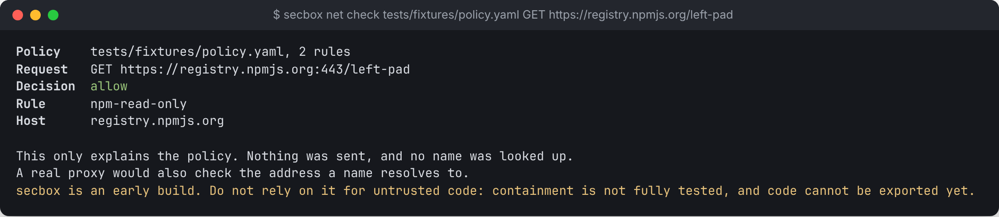

# Network policy and blocked hostnames

A sandbox's network is deny-by-default. Today the only rule on real traffic is the engine's **hostname allowlist**. secbox can also explain a fuller policy, with HTTP methods, ports and paths, but nothing enforces that policy yet.

## What is enforced today

When the daemon creates a sandbox, it gives the engine the list of hostnames the project may reach. Lookups for any other name are refused. Raw IP addresses, the cloud metadata address (`169.254.169.254`) and UDP were also blocked when tested.

The hostnames appear in the plan that `secbox up` shows before you approve it.

## Explaining a policy: `net check`

```sh
secbox net check POLICY METHOD URL
```

Answers one question: would this policy allow this request? It sends nothing and looks nothing up.

```sh
secbox net check policy.yaml GET https://registry.npmjs.org/left-pad    # allow, exit 0
secbox net check policy.yaml PUT https://registry.npmjs.org/left-pad    # deny, exit 4
```

```text
Policy    policy.yaml, 2 rules
Request   PUT https://registry.npmjs.org:443/left-pad
Decision  deny
Reason    rule npm-read-only does not allow this method

This only explains the policy. Nothing was sent, and no name was looked up.
A real proxy would also check the address a name resolves to.
```



Usernames, passwords and query strings in the URL are never printed.

### Policy file format

```yaml
version: 1
rules:
  - name: npm-read-only
    host: registry.npmjs.org
    ports: [443]
    methods: [GET, HEAD]
  - name: anthropic-messages
    host: api.anthropic.com
    ports: [443]
    methods: [POST]
    path_prefix: /v1/messages
```

| Key | Meaning |
| --- | --- |
| `version` | Always `1` |
| `rules` | A list. A request is allowed only if a rule allows it |
| `name` | Shown in the explanation |
| `host` | The exact hostname |
| `ports` | Allowed ports |
| `methods` | Allowed HTTP methods, in uppercase |
| `path_prefix` | Optional. The path must start with this |

Everything else is denied. Some addresses are denied whatever the rules say: cloud metadata endpoints, loopback, link-local, multicast and broadcast. Private ranges (such as `10.0.0.0/8` and `192.168.0.0/16`) are reachable only by a rule naming that exact IP.

## Blocked hostnames

```sh
secbox net blocked                # time, count and hostname, newest last
secbox net blocked -f             # keep checking; Ctrl-C stops
secbox net blocked --project PATH
secbox status                     # includes a count
```

In the [full-screen interface](terminal-ui.md), press `t` for the Traffic panel. The Projects panel shows the count in a Blocked box, in red when anything was refused.

**Read this before relying on the list:**

- **Hostnames only.** Raw IP, metadata and UDP attempts are blocked but not recorded. An empty list does not mean nothing was tried.
- **Only sandboxes created recently record anything.** A sandbox's log level is fixed when it is created. An older sandbox says nothing is being recorded. To record, recreate it with `secbox down --destroy` and `secbox up`, which deletes its data.
- **Events can be lost.** The engine keeps about 50 MB of log. On an idle sandbox that is about an hour. A busy or hostile sandbox can push events out within seconds. The output says when older events were cut off. `-f` sees events as they arrive, so it loses far fewer.
- **Counts are refused queries.** One lookup is usually two queries, for IPv4 and IPv6.
- **The guest chooses each name.** A name shows what was asked for and proves nothing else.

The record is the engine's log, read on the host by the daemon. In testing the guest could not write to it. If a check on the folders holding it fails, the output says the record is not trustworthy.

## Planned

- A gateway that enforces the policy above, including methods and paths, and records every decision on the host.
- `secbox net log`, to show allowed requests too.
- `secbox net allow`, to add a host with an approval prompt the sandbox cannot click.
