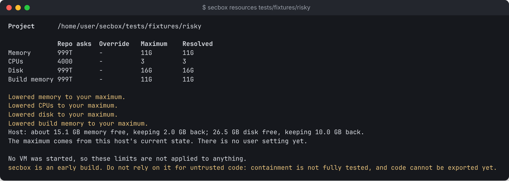
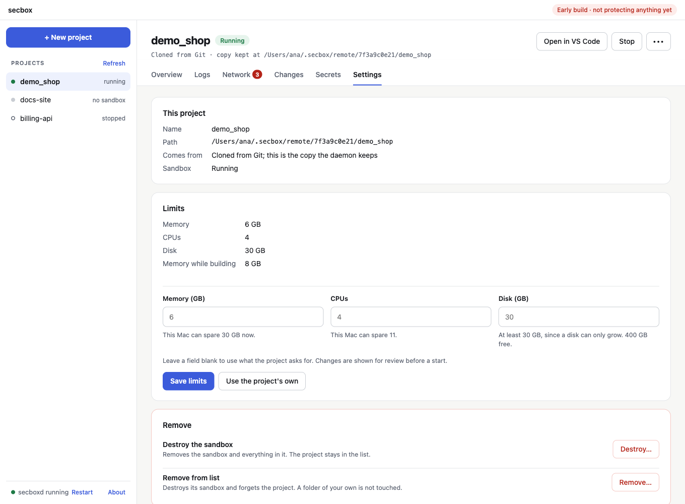
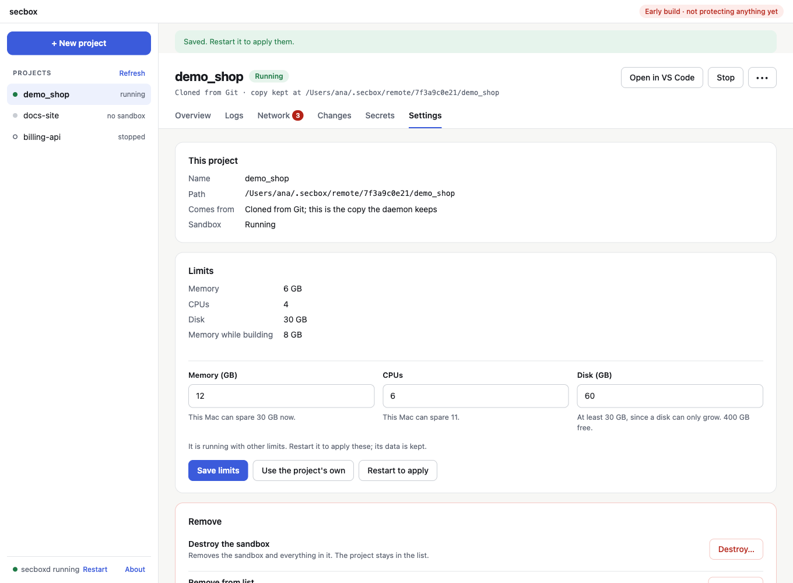
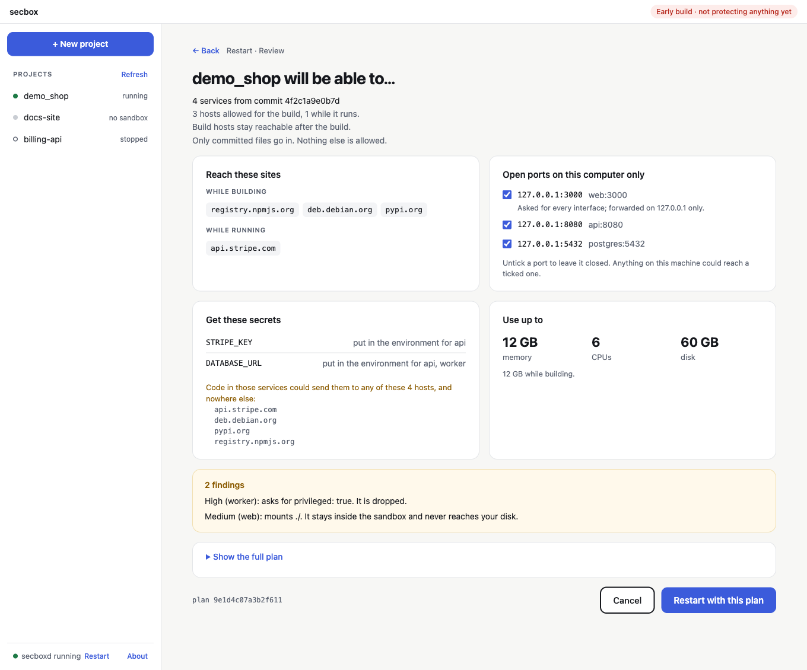
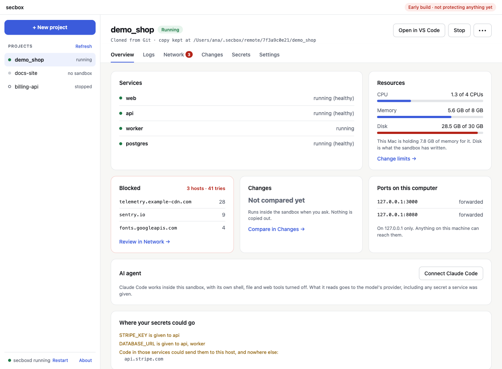
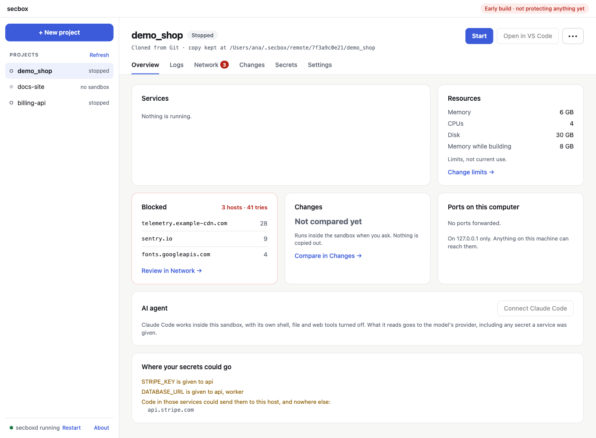
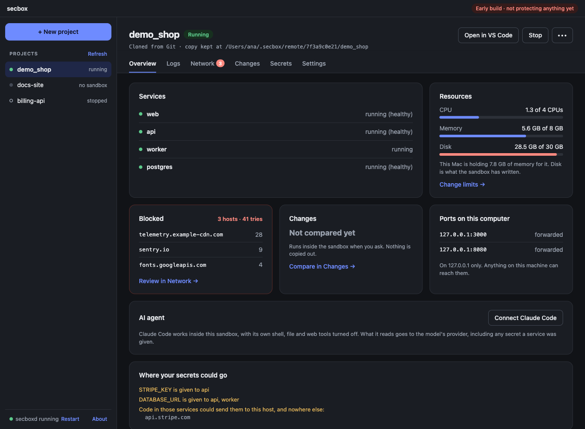
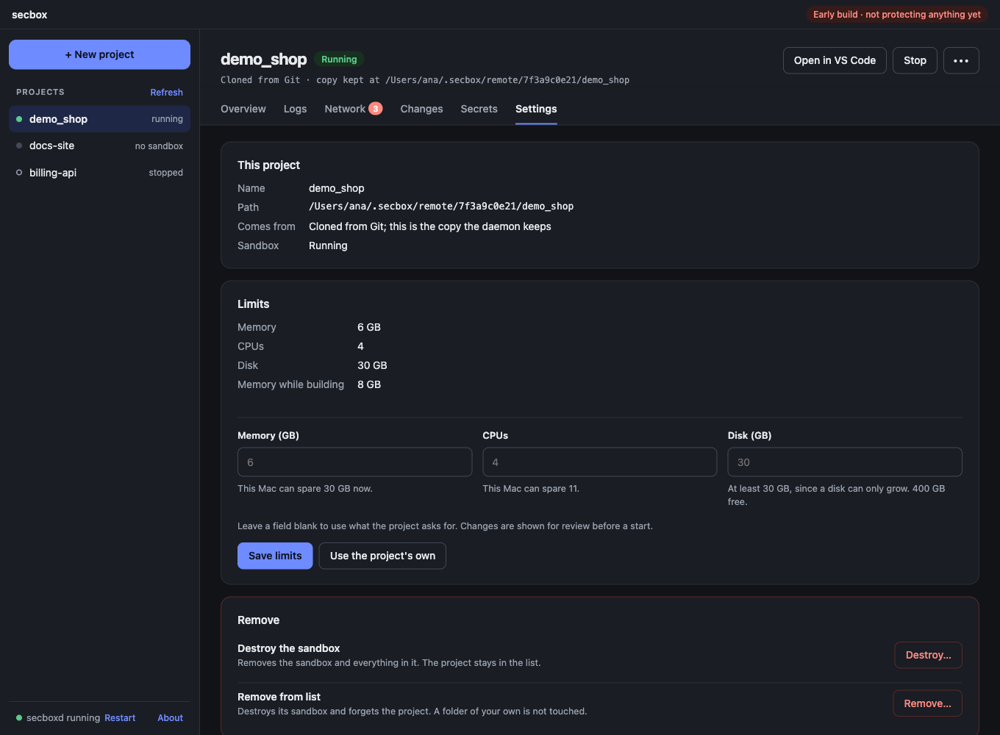

# RAM, CPU and disk

Each sandbox gets its own memory, CPU and disk limits. A project can ask for limits in `secbox.yaml`, but its request is never more than a request: secbox lowers it to what your machine can spare.

```sh
secbox resources                          # the current folder
secbox resources ~/code/myapp --memory 6G --cpus 4
```

## Asking for limits in a project

Commit a `secbox.yaml` at the project root. It holds no secret values.

```yaml
resources:
  memory: 6G
  cpus: 4
  disk: 30G
  build:
    memory: 8G    # optional, a higher limit while building
```

| Key | Format | Default when not set |
| --- | --- | --- |
| `memory` | A size such as `512M`, `4G` | `4G` |
| `cpus` | A number, such as `2` or `1.5` | `2` |
| `disk` | A size such as `20G` | `20G` |
| `build.memory` | A size | the same as `memory` |

Unknown keys are an error, so a typo is caught rather than ignored. The file can be at most 64 KB.

## How limits are resolved

```text
             Repo asks  Override   Maximum    Resolved
Memory       2G         6G         10G        6G
CPUs         1          3          11         3
Disk         5G         -          85G        5G
Build memory -          -          10G        6G
```



- **Repo asks**: what `secbox.yaml` requests.
- **Override**: what you passed with `--memory` or `--cpus`.
- **Maximum**: what this machine can spare right now, after keeping memory and disk back for the host.
- **Resolved**: the override if given, otherwise the request, lowered to the maximum.

If the host has too little free, `resources` says `Refused` and exits 1. `up` refuses to start in the same case.

The maximum comes from the host's current free memory and disk. There is no user setting for it yet.

## Changing limits in the app

Open a project's **Settings** tab, type a memory, CPU or disk limit, and choose **Save limits**. A blank field uses what the project asks for, and **Use the project's own** clears all three. Under each field is what this machine can spare now.



If the sandbox is running, it keeps its limits until it restarts, and a **Restart to apply** button appears:



Restarting shows the plan first. Check the new limits under **Use up to**, then choose **Restart with this plan**:



The screenshots on this page come from the app's preview, with sample data.

- Your choice is kept on this machine, never in the repository, and it replaces what `secbox.yaml` asks for. Choosing memory also sets the memory while building, so the VM is the size you typed.
- It can go above the maximum a repository is held to. Only what this machine has to keep for itself can refuse it.
- A running sandbox keeps its limits until it restarts. **Restart to apply** shows the new limits for review first, then stops and starts it. Its data stays.
- A disk can only grow. To make one smaller, destroy the sandbox, which deletes its data.

## Seeing what it uses

While a sandbox runs, the **Resources** card on the **Overview** tab shows CPU, memory and disk in use against each limit, every 10 seconds. A bar turns amber at 70% and red at 90%.



A stopped sandbox uses nothing, so the card shows its limits instead:



- **Memory** leaves out the guest's page cache. The note under it says what this machine is holding for the VM, which stays high after a build.
- **Disk** is what the sandbox has written to this machine's disk. It may not fall when files are deleted inside the sandbox.
- Some of these figures come from inside the guest, so a compromised sandbox could misreport them. Nothing acts on them.

The app follows your system's light or dark setting:





## How much to give

Measured with a seven-service Compose project:

| Usage | Measured |
| --- | --- |
| Fresh VM with Docker | About 160 MiB in the guest, 314 MiB on the host |
| Project running | 0.6 to 0.7 GiB |
| Project building, peak | 2.4 to 2.8 GiB |
| Smallest VM that built it | 3G worked; 2G failed every time |

Budget the full VM size on the host. Memory is not handed back after a build, so a 4G VM keeps about 4 GB on the host.

## Notes

- `secbox resources` only shows the numbers. No VM is started, and its `--memory` and `--cpus` are not kept. To keep a limit, use the app or `secbox.yaml`.
- Compose's own per-service memory and CPU limits still apply inside the VM.
- A changed limit takes effect the next time a stopped sandbox starts. Live resizing is not supported.
