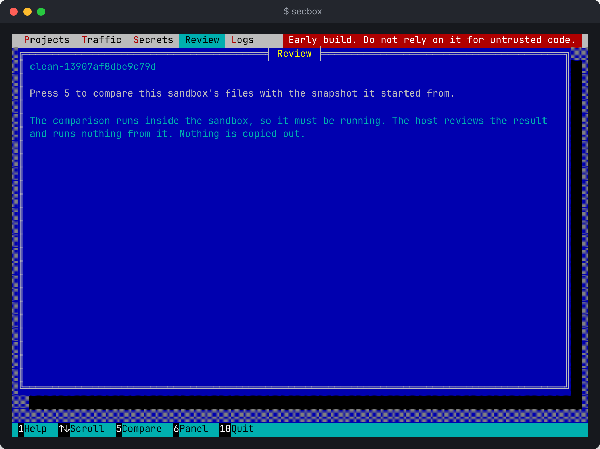

# Reviewing changes

`secbox diff` shows what changed inside a running sandbox since it started, and flags first the files that could act on your machine, such as a planted hook for an AI coding tool. It copies nothing out.

> **Built, and tested against a fake engine only. Never run on a real VM.** `export`, which would bring reviewed changes back to your machine, is not built. Nothing reviewed here can leave the sandbox yet.

```sh
secbox diff                     # the current folder's project
secbox diff ~/code/myapp
```

## Sample output

```text
Compared with the snapshot this sandbox started from (commit 1f2a12002068).

FLAG  .claude/settings.json  adds a hook for an AI coding tool, which would run on your machine
FLAG  .claude/settings.json  changes Claude Code settings, which can make it run commands on your machine

2 files changed:
  added     .claude/settings.json
  modified  api/server.js

2 flags to look at. Flags are a heuristic aid. Read the changes yourself before anything from this sandbox reaches your machine.
Nothing was copied out of the sandbox. Export is not built yet.
```

Flags come first, in red on a terminal. Then every changed file, marked `added`, `modified`, `deleted` or `type changed`.

## Exit codes

| Code | Meaning |
| --- | --- |
| 0 | Nothing was flagged |
| 5 | Something was flagged, or the review stopped at a limit |
| 1 | It could not compare, for example because the sandbox is not running |

So a script can stop on anything worth a look:

```sh
secbox diff || echo "read the flags before going further"
```

## What gets flagged

| Kind of file | Examples |
| --- | --- |
| AI coding tool settings and hooks | `.claude/`, `.cursor/`, `CLAUDE.md`, `AGENTS.md` |
| Editor settings | `.vscode/` |
| CI workflows | `.github/workflows/` |
| Git hooks | `.husky/` and similar |
| Install scripts and lockfiles | `package.json` scripts, `package-lock.json` |
| Build files | `Dockerfile`, Compose files |
| Odd files | Symlinks, binaries, likely secrets |

Names are matched the way a case-insensitive filesystem would, so `.CLAUDE/Settings.json` is flagged too, as are lookalikes that hide invisible characters in a name.

Flags are a heuristic aid. A harmful change to an ordinary source file is not flagged. Read the changes yourself.

## How it works

1. **A baseline the sandbox cannot change.** When a sandbox is created, the daemon commits the snapshot itself and keeps that commit in the project's state folder, as `baseline.git`. The sandbox gets the same commit as `/work/.git`. Whatever the sandbox does to its own history, `diff` compares with the host's copy.
2. **Git runs only inside the sandbox.** On `diff`, Git in the sandbox commits everything in `/work` onto a throwaway branch, uncommitted changes included, and sends a bundle of it back as text. The daemon stops reading at 128 MB.
3. **The bundle is treated as hostile.** The daemon checks it, imports it into a new quarantine repository and reviews it there. Nothing from it is checked out or run, and Git on your machine never runs in a `.git` folder the sandbox wrote. A malformed, oversized or tricked bundle is refused.

If the sandbox rewrites its history so it no longer starts from the snapshot, `diff` says so and exits 5.

## In the full-screen interface

Press `c` for the selected project's Changes tab, then `r` to compare. It shows the same lines, flags first in red. Comparing runs inside the sandbox, so it never starts by itself. Up, down, PgUp and PgDn scroll. See [Full-screen terminal interface](terminal-ui.md).



## In the desktop app

The **Git review** page shows the same comparison, with a **Compare** button. See [Desktop app](desktop-app.md).

## Limits

- **The sandbox must be running.** `diff` never starts one.
- **Ignored files are not shown.** Files the project's `.gitignore` leaves out are not in the comparison, and would not be in an export either.
- **Older sandboxes have no baseline.** A sandbox created before `diff` existed has nothing to compare with, and `diff` says to recreate it with `secbox down --destroy` and `secbox up`. That deletes its data.
- **The VM image needs Git.** This has not been checked on a real VM.
- **No export yet.** Changes stay in the sandbox, and `down --destroy` deletes them.
