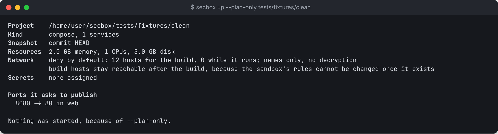
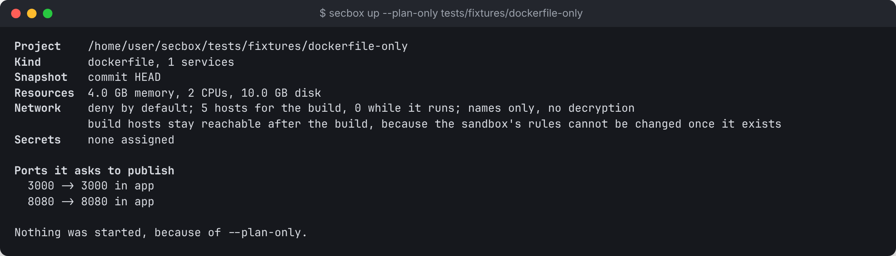

# Running a project in a sandbox

`secbox up` starts a project in its own VM, `secbox status` shows it, and `secbox down` stops or destroys it. All three need the daemon (`secboxd`) running.

> Built, and has run on a real Mac. See [What works today](../start/status.md).

`secbox new` sends the same requests with one review and one question. See [Bringing a project in](new.md).

## Before you start

- The project must be a **Git repository with at least one commit**. secbox copies a commit into the VM, never your working folder.
- It must have a **Compose file** or a **`Dockerfile` at its root**.
- The daemon must be running: `secboxd`, or the desktop app.

## Start

```sh
secbox up                  # the project in the current folder
secbox up ~/code/myapp     # another folder
```

### 1. The plan

`up` first prints a plan. Nothing has started yet. The plan shows:

- the commit that will be copied in
- the services, and the ports they ask to publish
- the hostnames the sandbox may reach, for the build and while it runs
- **Where secrets could go**: each secret name and the service that receives it
- memory, CPU and disk limits
- findings from the same checks as `secbox check`

If anything blocks the start, `up` lists it under **This cannot be started yet** and stops with exit code 1. Common blockers are too little memory or disk on the host, or a privileged service in a project that has secrets.



To see the plan and stop there:

```sh
secbox up --plan-only
```

### 2. Ports

Next it asks which ports to forward:

```text
Forward 3000, 8080 to 127.0.0.1? Anything on this machine could then reach them. [y/N]
```

Only `y` forwards them. Ports are forwarded to `127.0.0.1` only, never to your network, and always to the same port number, because some apps expect a particular `localhost` address.

To choose without the question:

```sh
secbox up --port 3000            # only 3000
secbox up --port 3000 --port 8080
secbox up --all-ports            # every port in the plan
```

`--port` accepts only ports the plan lists.

### 3. Starting

On a Mac, the daemon first asks you to confirm with Touch ID or your password, in a prompt naming the project and how many secrets, hosts and ports it gets. Cancel, and nothing is created. Linux has no prompt; `up` says so. See [Confirming with Touch ID](../concepts/confirming.md).

The daemon copies the commit in, boots the VM, starts Docker and runs `docker compose up --build`. The first start downloads images and builds, so it can take several minutes. When it finishes:

```text
Started   in 94s
Secrets   API_KEY -> api
...
Ready     http://127.0.0.1:3000

What runs inside the sandbox is untrusted. Its own reports can be wrong.
```

## Choosing what goes in

| Option | What starts |
| --- | --- |
| *(nothing)* | `HEAD` |
| `--commit <ID>` | That commit, named by its **full** 40-character id |
| `--include-uncommitted` | Planned. The daemon currently refuses it: commit first |

Some files never enter the sandbox, whatever the commit holds: `.env` files, private keys, cloud and tool credentials, password stores and Terraform state. Example files such as `.env.example` are kept.

## Status

```sh
secbox status
secbox status ~/code/myapp
```

Shows whether the sandbox is running, each service and its health, the forwarded ports, resource limits and how many hostname lookups were refused.

## Review changes

```sh
secbox diff
```

Lists what changed in the sandbox since it started, with risky files flagged first. See [Reviewing changes](reviewing-changes.md).

## Stop

```sh
secbox down
```

Stops the VM and keeps its data for the next `up`. Stopping is abrupt for what runs inside, so a database may run crash recovery on the next start.

## Destroy

```sh
secbox down --destroy
```

Removes the VM and everything in it: the copy of the project, images, build caches, data volumes and any changes made inside. The host's baseline commit for [`diff`](reviewing-changes.md) goes too. **Rotate every secret the sandbox was given** if you suspect it was compromised.

## Remove a project

```sh
secbox remove              # the project in the current folder
secbox remove ~/code/myapp # another folder, even one that no longer exists
```

`down --destroy` removes the sandbox but keeps the project listed, with its approved ports and hosts. `remove` does that and also deletes those records, so the project leaves the list. In the desktop app this is **Remove project**.

For a project imported from a remote, the copy on your machine goes too. The remote is not touched. **A folder of your own is never deleted.** Secrets stay in your keychain.

## Projects with only a Dockerfile

If the project has a `Dockerfile` at its root and no Compose file, the daemon writes a one-service Compose file for it:

- one service named `app`, built from the project with that Dockerfile
- no volumes and no extra privileges
- ports from the `EXPOSE` lines in the **last** build stage, TCP only

Variables, ranges, UDP and anything unusual in `EXPOSE` are listed in the plan and left out. Each port is still forwarded only if you approve it.



The generated file is shown in the plan and covered by its approval. It is placed at `/work/compose.yaml` in the sandbox.

## Not supported yet

- Dev containers (`.devcontainer`).
- Projects with only a package manifest, such as `package.json` with no Dockerfile.
- Live resizing. Limits apply at start.
