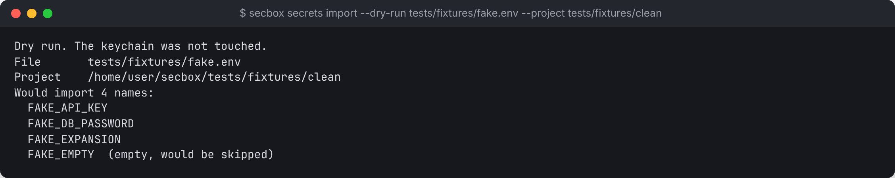

# Secrets

secbox keeps secret values in your operating system's keychain and gives each one only to the services you name. Values never go into the project, a secbox file, a command-line argument or the sandbox's disk.

```sh
secbox secrets set API_KEY --service api      # type the value at a hidden prompt
secbox secrets import .env --dry-run          # see which names a .env holds
secbox secrets import .env                    # store them
secbox secrets import .env.example            # add its names, empty, to fill in
secbox secrets fill                           # type a value for each empty name
secbox secrets list                           # names and where they go, never values
secbox secrets rm API_KEY
```

Every command takes `--project PATH` to name a project in another folder. Secrets are stored per project.

## Where values are kept

| OS | Store |
| --- | --- |
| macOS | Keychain, under the service name `secbox` |
| Linux | Secret Service (GNOME Keyring, KWallet and others), over D-Bus |

secbox's own state folder holds **names only**: which secrets exist, how each was stored, and which services get it. The audit log records names, never values.

## Storing one secret

```sh
secbox secrets set NAME [--service S]... [--as-file] [--build] [--proxy-host HOST]
```

You type the value twice at a hidden prompt. There is no way to pass a value as an argument, because arguments are visible to other programs in the process list. If you try, secbox refuses with exit code 2 and does not print the value.

| Option | Meaning |
| --- | --- |
| `--service NAME` | A Compose service that may receive it. Repeat for more than one. Without it, the secret is stored but goes nowhere |
| `--as-file` | Deliver it as a file at `/run/secrets/NAME` instead of an environment variable. Narrower, but the program has to read a file |
| `--build` | Deliver it only to the build, as a build secret. **Recorded, but not delivered yet** |
| `--proxy-host HOST` | Keep it on the host and have a proxy add it to requests for this one host. **Not built: a project with such a secret will not start** |

## Importing a .env file

```sh
secbox secrets import path/to/.env --dry-run
secbox secrets import path/to/.env
```

The file is parsed as data. It is never run through a shell, so a line like `X='$(touch /tmp/pwned)'` stores that text literally and runs nothing. `export NAME=value` and quoted values are understood. A name with an empty value is added as an empty name to [fill in](#filling-in-empty-names). Output lists names only:

```text
Dry run. The keychain was not touched.
File       tests/fixtures/fake.env
Project    /home/you/code/myapp
Would import 4 names:
  FAKE_API_KEY
  FAKE_DB_PASSWORD
  FAKE_EXPANSION
  FAKE_EMPTY  (empty, would be added to fill in later)
```



Imported secrets go to no service until you assign them. Run `secbox secrets set NAME --service S` for each, typing the value again.

## Importing a template

```sh
secbox secrets import .env.example
```

A template lists the names a project needs, with placeholder values. When the file name has `example`, `sample`, `template`, `dist` or `defaults` as one of its dot-separated parts (`.env.example`, `example.env`, `.env.local.sample`), secbox adds **only the names**, as empty names. The values in the file are dropped without being stored, shown or written anywhere, since a template sometimes holds a real key by mistake. The keychain is not opened.

```text
File       .env.example
Project    /home/you/code/myapp
Names only. The values in this file were not kept.

  STRIPE_KEY               added, empty
  DATABASE_URL             added, empty
  API_KEY                  already stored, left as it is

2 empty. Run `secbox secrets fill` to type their values, or
`secbox secrets set NAME` for one.
```

A name that already has a value is left as it is. Use `--names-only` to treat any file this way, and `--dry-run` to see the names without recording them.

## Filling in empty names

```sh
secbox secrets fill
```

Asks for each empty name in turn, at a hidden prompt, twice. Press Enter on its own to skip a name, which stays empty. If the two values differ, that name is skipped and nothing is stored for it. Each value goes to the keychain as soon as it is confirmed, so stopping part way keeps the ones already typed. `secbox secrets set NAME` fills in a single name.

Empty names have no value, so nothing is delivered for them. Like imported secrets, filled-in ones go to no service until you assign them with `secbox secrets set NAME --service S`.

## From the desktop app

The desktop app's **Secrets** tab lists the same names as `secrets list`, stored and empty. *Set value* (for an empty name) or *Replace* opens a masked field under the row, with a checkbox for each service in the project's Compose file; *+ Add a secret* does the same for a new name. *Save to keychain* sends the value to the daemon, which checks the name and services, stores it in the keychain and records the assignment. Leave every service unticked to store it without giving it to any.

The window is write-only: it can replace a value, but nothing in it can show one. The value you type passes through the app's web page on its way to the daemon. The page cannot wipe it from memory as the terminal does, so on a shared or untrusted machine prefer `secbox secrets fill`. A secret that was set to be delivered as a file (`--as-file`) keeps that when it is replaced from the window. A new value reaches a running sandbox on its next start.

## Listing

```sh
secbox secrets list
```

Shows the project's id, then each name, how it was stored (`prompt` or `import`, or `empty` for a name with no value yet) and where it goes (a service, `no service`, or `not set yet`). The Secrets panel in the [terminal UI](terminal-ui.md) shows the same list. It reads secbox's metadata only and never opens the keychain, so it never shows a value and macOS never asks for permission.

## How a secret reaches a service

On every `secbox up`:

1. The daemon reads the values from the keychain.
2. It mounts a small `tmpfs` inside the VM (`noexec,nosuid,nodev`, owner-only). If that mount cannot be made, the start stops, rather than write a secret to disk.
3. Values are sent in over standard input, never as arguments.
4. Each service gets only the secrets assigned to it, as environment variables or as files under `/run/secrets`.

Because the `tmpfs` disappears when the VM stops, this happens again on each start.

A service that was not given a secret gets nothing of it: no environment variable, no file, and no mention in the Compose override secbox adds. Setting `${STRIPE_KEY}` in another service's own `environment:` does not reach it either, because the value is never in Compose's environment or in a `.env` in the snapshot.

**A project with only a Dockerfile** runs as one service, `app`, so that is the only service a secret can go to. Secrets reach the running container only. The image is built without them, so a `RUN` step cannot read one and none is baked into the image. A build that needs a token, such as for a private package registry, is not supported yet.

`up` prints a **Where secrets could go** section in the plan, and a `Secrets` line per service once started. It lists each secret, which service holds it, every host the sandbox can reach, and which of those hosts accept uploads from anyone. `secbox status` shows the same.

## What this does not protect

- **A service can read every secret it was given**, and so can anything sharing its container.
- **Masking is only for accidents.** `secbox logs` and `secbox net blocked` show a secret's name, such as `[API_KEY]`, in place of its value, including base64, URL-encoded and hex forms. A value that has been encrypted or reworked is not recognised.
- **`secbox exec` and `secbox shell` can read it, unmasked.** So can an [AI agent](ai-agents.md) using the `exec` tool, and its model provider then sees it.
- **No privileged services.** A project with any secret assigned will not start if a service asks for a host mount, the Docker socket or `privileged`, because that service could read the others' secrets.

After a suspected compromise, run `secbox down --destroy` and rotate every secret that sandbox was given.

## Removing

```sh
secbox secrets rm NAME
```

Deletes it from the keychain and the metadata. An empty name is just dropped from the list. `secbox uninstall --purge` does **not** remove keychain entries, so remove secrets with `rm` first.
