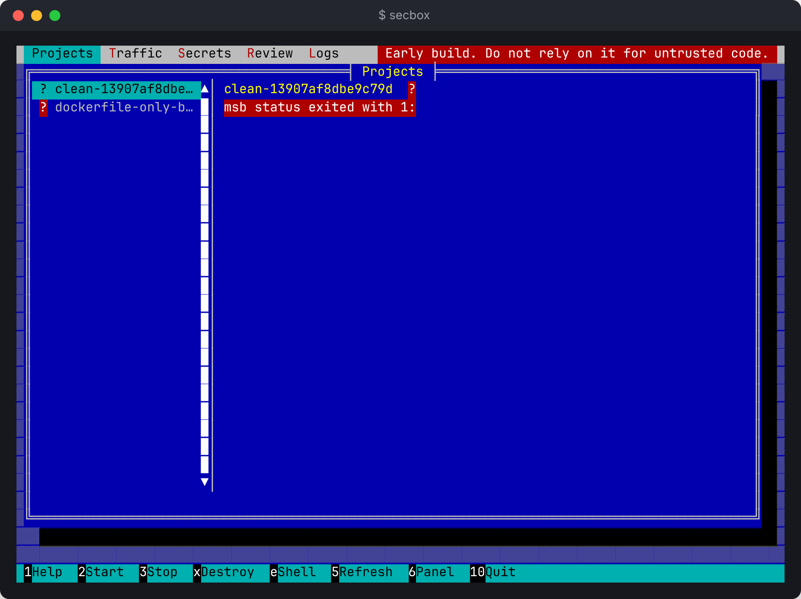
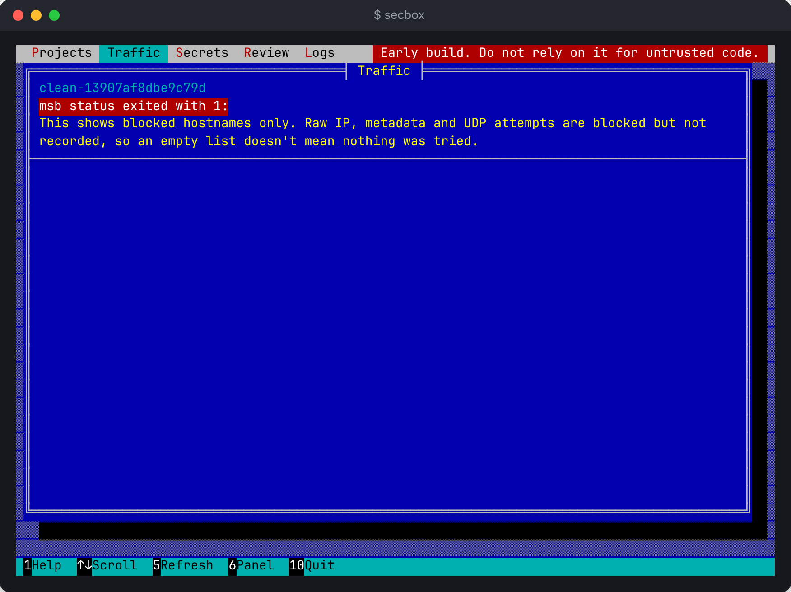
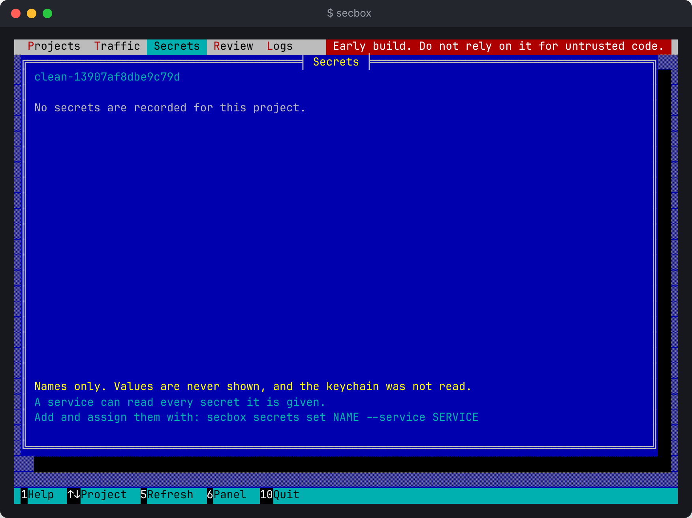

# Full-screen terminal interface

Run `secbox` with no arguments to open a full-screen interface. It shows every project the daemon knows about, and lets you start, stop and destroy sandboxes, follow logs, see blocked traffic and list secret names. It is one more client of the same daemon, with the same powers as the commands.

```sh
secbox
```

The terminal must be at least 60 columns by 14 rows. The red tag at the right of the menu bar, saying this is an early build, never goes away.



These screenshots come from a real daemon with no VM engine, so the project's state is unknown (`?`) and the status error is real.

## Panels

| Key | Panel | Shows |
| --- | --- | --- |
| `p` | Projects | Each project's state, with boxes for its services, ports on `127.0.0.1`, resources and blocked lookups |
| `l` | Logs | Recent and new log lines, for all services or one |
| `t` | Traffic | Blocked hostnames, newest last |
| `s` | Secrets | Secret names, how each was stored and which services get it. Never values |
| `r` | Review | Not built yet |

`Tab` moves to the next panel. The bar along the bottom lists only the keys that work on the panel showing.

## Keys

| Key | Where | What it does |
| --- | --- | --- |
| Up, Down (or `k`, `j`) | Everywhere | Choose a project, or scroll |
| PgUp, PgDn | Logs, Traffic | Scroll a page |
| `2` or `u` | Projects | Start the selected project |
| `3` | Projects | Stop it, after confirming |
| `x` | Projects | Destroy it, after confirming |
| `e` | Projects, Logs | Open a shell, in the chosen service on Logs |
| Left, Right (or `[`, `]`) | Logs | Choose a service or All |
| `f` or End | Logs | Follow new lines again |
| `5` | Everywhere | Read again |
| `y`, `n` | Questions | Answer yes or no. Esc means no |
| `1` or `?` | Everywhere | Help for this panel |
| `q`, `0` or Ctrl-C | Everywhere | Quit |

Starting, stopping and destroying work only on Projects.

## Traffic



## Logs

The Logs panel follows new lines by itself and says `Following` at the top right. Scrolling up pauses it: the tag changes to `Paused` and counts lines that arrive. `f`, End, or scrolling back to the newest line follows again.

## Shells

Pressing `e` steps the interface aside and opens the same shell as `secbox shell`. When you leave the shell, the interface comes back and says the shell's exit code. On a stopped project, `e` says there is no running sandbox.

## Starting

Pressing `2` on a stopped project shows a summary of the plan, including the ports that would be forwarded to `127.0.0.1`. `y` starts it with those ports, and `n` or Esc cancels. To pick ports one by one, use `secbox up --port` instead. While it starts, a box lists each step as the daemon reports it, the same steps `secbox up` prints. Keys do nothing until it ends.

## Secrets panel



Reads the same metadata as `secbox secrets list`. It never opens the keychain and changes nothing. Use the `secrets` commands to change secrets.
