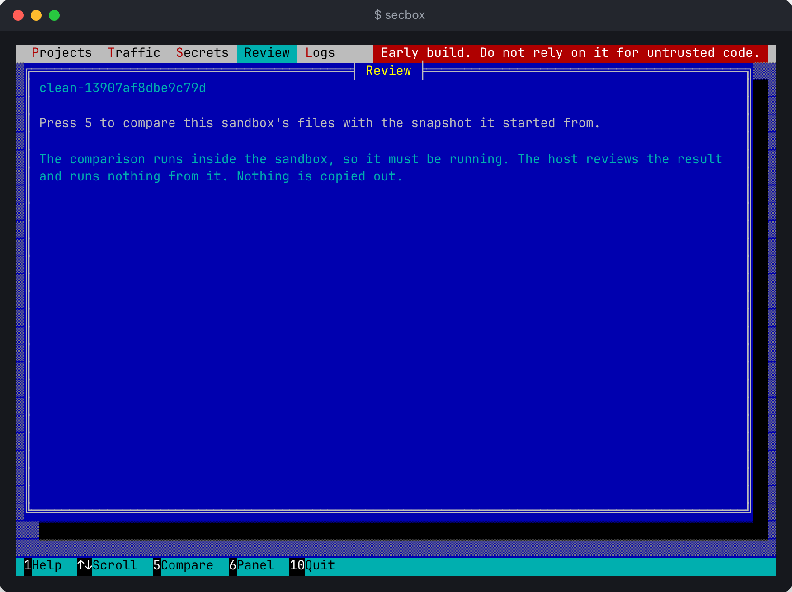

# Full-screen terminal interface

Run `secbox` with no arguments to open a full-screen interface. It shows every project the daemon knows about, and lets you bring a project in, start, stop and destroy sandboxes, follow logs, see blocked traffic, compare changes and list secret names. It is one more client of the same daemon, with the same powers as the commands.

```sh
secbox
```

The terminal must be at least 60 columns by 14 rows. The red tag at the right of the top bar, saying this is an early build, never goes away. The bar along the bottom lists only the keys that work where you are, and says at the right whether the daemon answered (`● daemon`, or `daemon off`).

The screenshots on this page show the previous layout and have not been retaken yet.

## Bringing a project in

With no project yet, the page offers two ways in, in two boxes:

- `g` **Clone from Git.** Paste an SSH remote and press Enter. It is fetched on this machine with your SSH key, which never goes into the sandbox.
- `f` **Add a folder.** Type a path (a leading `~` is your home folder) and press Enter. If you started `secbox` inside a folder that looks like a project (it has a Compose file, a Dockerfile, a dev container or a package manifest), that folder is already filled in and chosen.

Left and right choose a box and Enter opens it. While typing, Esc cancels. Either way the next thing you see is the plan, as described under [Starting](#starting); nothing starts until you agree to it. `secbox new git@…` or `secbox new .` does the same without this screen.

Once there are projects, `+` (or `N`) shows the same two boxes beside the list, and Esc goes back.

## Projects and tabs

Projects are listed down the left, each with a mark for its state: `●` running, `○` stopped, `·` no sandbox, `?` unknown. Above the list is `+ New project`. On the right, the selected project's name, state and folder sit over its tabs. Each tab opens with the letter drawn on it:

| Key | Tab | Shows |
| --- | --- | --- |
| `o` | Overview | Boxes for the services, ports on `127.0.0.1`, resource limits and blocked lookups |
| `l` | Logs | Recent and new log lines, for all services or one |
| `n` | Network | Blocked hostnames, newest last. The tab carries the number of hostnames refused |
| `c` | Changes | What changed in the sandbox, flags first, after you compare. Pull and push are here too. The tab carries the number of changed files |
| `s` | Secrets | Secret names, how each was stored and which services get it. Never values |

`Tab` and Shift-Tab move to the next and previous tab.

## Keys

| Key | Where | What it does |
| --- | --- | --- |
| Up, Down (or `k`, `j`) | Overview, Secrets | Choose a project |
| Up, Down, PgUp, PgDn | Logs, Network, Changes | Scroll |
| `u` (or F2) | Overview, not running | Start the selected project, after showing the plan |
| `S` (or F3) | Overview, running | Stop it, after confirming |
| `x` | Overview, with a sandbox | Destroy it, after confirming |
| `e` | Overview, Logs, running | Open a shell, in the chosen service on Logs |
| Left, Right (or `[`, `]`) | Logs | Choose a service or All |
| `f` or End | Logs | Follow new lines again |
| `r` (or F5) | Every tab | Read again. On Changes, compare |
| `p`, `P` | Changes | Git pull, and push of the current branch, with your SSH key on this machine |
| `+` or `N` | Every tab | New project |
| `g`, `f` | New project | Clone from Git, add a folder |
| `y` | Questions | Yes. Only `y` agrees |
| `n`, Esc, Enter | Questions | No, which is the default |
| `?` (or F1) | Everywhere | Help for where you are |
| `q`, Ctrl-C (or F10) | Everywhere but while typing | Quit |

Starting, stopping and destroying work only on Overview, and only the ones the project's state allows: a running project offers Stop and no Start. The letter that opens a tab never does anything else, so a key pressed to look at something cannot stop a sandbox.

## Logs

The Logs tab follows new lines by itself and says `Following` at the top right. Scrolling up pauses it: the tag changes to `Paused` and counts lines that arrive. `f`, End, or scrolling back to the newest line follows again.

## Shells

Pressing `e` steps the interface aside and opens the same shell as `secbox shell`. When you leave the shell, the interface comes back and says the shell's exit code.

## Starting

Pressing `u` asks the daemon for the plan and shows it in a box, in the same groups as the review in the desktop app:

- **Reach these sites:** the hosts allowed while building and while running.
- **Open ports on this computer only:** each port that would be forwarded to `127.0.0.1`, and the service behind it.
- **Get these secrets:** each secret's name, the services it goes to and how, and every host it could be sent to.
- **Use up to:** memory, CPUs and disk.
- **Findings:** the high and critical findings, files that look like they hold a secret, and a count of the rest.

`y` starts it with those ports. `n`, Esc and Enter cancel: No is the default. A plan longer than the terminal scrolls with up and down, and `y` works only once all of it has been on screen. Keys pressed before the box appeared, such as the rest of a paste, are thrown away. To pick ports one by one, use `secbox up --port` instead. While it starts, a box lists each step as the daemon reports it, the same steps `secbox up` prints. Keys do nothing until it ends.

On a Mac, after `y` the daemon asks you to confirm with Touch ID or your password, in macOS's own prompt. The busy line and the box say "Confirm with Touch ID or your login password" until you answer. The interface can't answer it for you. On Linux there is no prompt: the box says so, and the result ends with "Not confirmed by fingerprint". See [Confirming with Touch ID](../concepts/confirming.md).

## Changes

The Changes tab shows the same comparison as [`secbox diff`](reviewing-changes.md), flags first in red. Press `r` to compare: it runs inside the sandbox, so it never runs by itself. Up, down, PgUp and PgDn scroll. `p` pulls and `P` pushes the current branch through the daemon's relay, and a box shows what Git said. On a Mac, each push waits for your Touch ID, in a prompt naming the branch and commits; cancel it and the remote gets nothing.



## Network


Pressing `a` on a blocked hostname asks for Touch ID on a Mac before anything is saved or restarted.

## Secrets


Reads the same metadata as `secbox secrets list`. It never opens the keychain and changes nothing. Names added from a template such as `.env.example` that have no value yet show in amber as `empty / not set yet`, and a line at the bottom counts them and names `secbox secrets fill`. Use the `secrets` commands, or the desktop app's Secrets tab, to change secrets.
