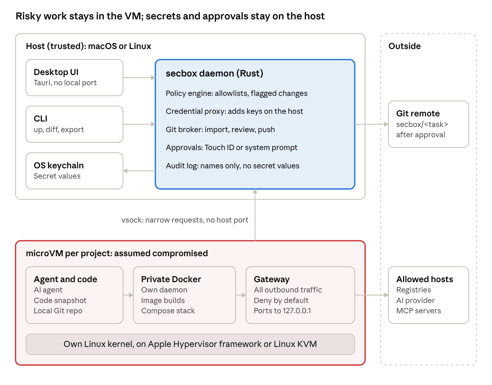

# secbox

secbox runs a project and its AI agent inside a disposable microVM, so that a compromised dependency or a tricked agent stays away from your machine.

> **Early build. Do not rely on secbox to contain anything yet.** Most commands were built against a fake engine, and only some have run on a real VM. Read [What works today](start/status.md) before you try it.

## The problem

Recent supply-chain attacks run at install time. A package's install script steals your cloud keys, Git tokens and publishing tokens, then uses them to spread. An AI agent with a shell can be tricked by text in a README or an issue into doing the same. A firewall that blocks incoming connections does nothing about either.

## The idea

Each project gets its own small virtual machine, with its own Linux kernel and its own Docker daemon. Your Compose stack builds and runs in there, unmodified. Your machine keeps the things worth stealing:

- **Secrets** stay in the macOS Keychain or Linux Secret Service, and only named services receive them.
- **Network access** is deny-by-default, with an allowlist of hostnames.
- **Ports** are forwarded to `127.0.0.1` only, and only the ones you approve.
- **Git credentials** never enter the VM.

Everything inside the VM is treated as compromised. When you are done, or if you suspect a problem, you destroy the VM.

## Where to go next

| If you want to | Read |
| --- | --- |
| Know what is real and what is still a plan | [What works today](start/status.md) |
| Install it | [Install](start/install.md) |
| Try it in five minutes | [Quick start](start/quickstart.md) |
| Understand what it protects against | [Security model](concepts/security-model.md) |
| See what a sandbox changed | [Reviewing changes](guides/reviewing-changes.md) |
| Use Claude Code or Codex with a sandbox | [AI agents over MCP](guides/ai-agents.md) |
| Look up a command | [Command line](reference/cli.md) |
| Feed these docs to an AI assistant | [Using these docs with an AI](for-ai.md) |

## About the name

`secbox` is a working name and may change before a first release. An unrelated openSUSE package already uses it.
