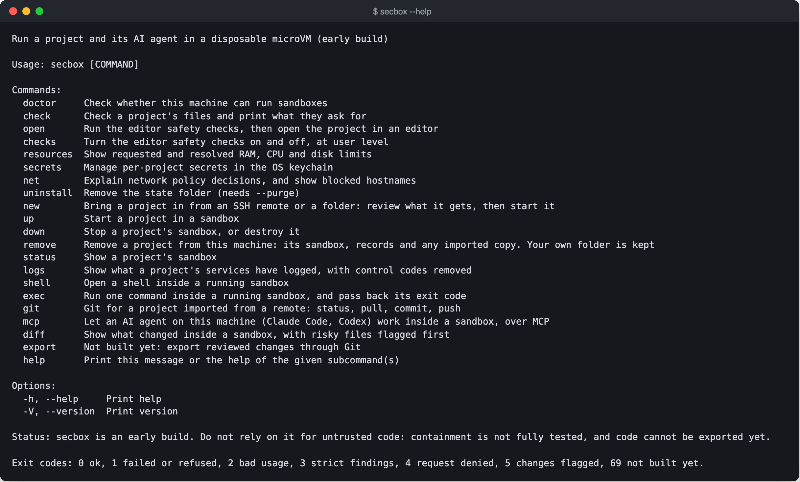

# Command line

Every `secbox` command, its arguments and options. `secbox COMMAND --help` prints the same information.

```text
secbox [COMMAND]
```



With no command, `secbox` opens the [full-screen interface](../guides/terminal-ui.md).

Where a command takes `[PATH]` or `--project PATH`, the default is the current folder. Relative paths are resolved from the current folder.

| Command | Needs the daemon | Summary |
| --- | --- | --- |
| [`doctor`](#doctor) | No | Check whether this machine can run sandboxes |
| [`check`](#check) | No | Check a project's files and print what they ask for |
| [`open`](#open) | No | Run the editor safety checks, then open the project in an editor |
| [`checks`](#checks) | No | Turn the editor safety checks on and off |
| [`resources`](#resources) | No | Show requested and resolved RAM, CPU and disk limits |
| [`secrets`](#secrets) | No | Manage per-project secrets in the OS keychain |
| [`net`](#net) | `blocked` only | Explain network policy decisions, and show blocked hostnames |
| [`uninstall`](#uninstall) | No | Remove the state folder |
| [`new`](#new) | Yes | Bring a project in from an SSH remote or a folder: review what it gets, then start it |
| [`up`](#up) | Yes | Start a project in a sandbox |
| [`down`](#down) | Yes | Stop a project's sandbox, or destroy it |
| [`status`](#status) | Yes | Show a project's sandbox |
| [`logs`](#logs) | Yes | Show what a project's services have logged |
| [`shell`](#shell) | Yes | Open a shell inside a running sandbox |
| [`exec`](#exec) | Yes | Run one command inside a running sandbox |
| [`mcp`](#mcp) | `serve` only | Let an AI agent on this machine work inside a sandbox |
| [`diff`](#diff) | Yes | Show what changed inside a sandbox, with risky files flagged first |
| `export` | | Not built yet. Exits with 69 |

Global options: `-h`, `--help` and `-V`, `--version`.

---

## doctor

```text
secbox doctor
```

Checks the platform, hypervisor, CPU, memory, disk, state folder, socket path length and engine. Prints `ok`, `warn` or `fail` for each, with a `next` line saying what to do. Ends with suggested limits. Exits 1 if any check failed. Does not need Docker.

## check

```text
secbox check [OPTIONS] [PATH]
```

| Option | |
| --- | --- |
| `--strict` | Exit with code 3 on Critical or High findings, or an unsupported project |
| `--fix` | Offer to change user editor settings that failed a check. Never project files |

See [Checking a project](../guides/checking-a-project.md).

## open

```text
secbox open [OPTIONS] [PATH]
```

| Option | |
| --- | --- |
| `--editor NAME` | `vscode` (default), `vscode-insiders` or `cursor` |
| `--force` | Start the editor even though a check failed. This is recorded |
| `--dry-run` | Run the checks and say what would start, without starting it |

See [Editors](../guides/editors.md).

## checks

```text
secbox checks list
secbox checks on ID
secbox checks off ID
```

Lists the editor safety checks, or turns one on or off by its id. Stored at user level, never read from a project.

## resources

```text
secbox resources [OPTIONS] [PATH]
```

| Option | |
| --- | --- |
| `--memory SIZE` | Use this memory limit instead of the repo's, such as `6G` |
| `--cpus COUNT` | Use this CPU limit instead of the repo's, such as `4` or `1.5` |

See [RAM, CPU and disk](../guides/resources.md).

## secrets

```text
secbox secrets import [--dry-run] [--names-only] [--project PATH] FILE
secbox secrets fill [--project PATH]
secbox secrets set [OPTIONS] NAME
secbox secrets list [--project PATH]
secbox secrets rm [--project PATH] NAME
```

| Subcommand | |
| --- | --- |
| `import FILE` | Import a `.env` file as data into the keychain. Prints names only. Empty values become empty names to fill in. A template such as `.env.example` adds only its names, empty, and its values are dropped; `--names-only` does the same for any file. `--dry-run` shows the names without recording anything |
| `fill` | Type a value at a hidden prompt for each empty name. Enter on its own skips one |
| `set NAME` | Store one secret, typed at a hidden prompt |
| `list` | List secret names and where they go. Never reads the keychain |
| `rm NAME` | Delete one secret from the keychain and the metadata |

Options for `set`:

| Option | |
| --- | --- |
| `--service NAME` | Service that may receive it. Repeat for more than one |
| `--as-file` | Deliver it as a file at `/run/secrets/NAME` instead of in the environment |
| `--build` | Deliver it only as a build secret. Not delivered yet |
| `--proxy-host HOST` | Keep it on the host and add it in the proxy, for this one host. Not built: `up` refuses |
| `--project PATH` | Project folder |

See [Secrets](../guides/secrets.md).

## net

```text
secbox net check POLICY METHOD URL
secbox net blocked [--project PATH] [-f]
```

| Subcommand | |
| --- | --- |
| `check` | Explain whether a policy file allows one request. `METHOD` is uppercase, such as `GET`. `URL` is a full URL. Exits 4 when denied |
| `blocked` | Show blocked hostnames recorded for a project, with secret values masked. `-f`, `--follow` keeps checking until Ctrl-C. Raw IP, metadata and UDP attempts are not recorded |

See [Network](../guides/network.md).

## uninstall

```text
secbox uninstall [--purge] [--yes]
```

| Option | |
| --- | --- |
| `--purge` | Actually remove the state folder. Without this, nothing is removed and it exits 2 |
| `--yes` | Do not ask for the name to be typed |

See [Uninstall](../uninstall.md).

## new

```text
secbox new [OPTIONS] <GIT-URL | PATH>
```

Fetches an SSH remote on this machine, or takes a folder's last commit, then shows what the project will be able to reach, open, get and use, and asks `Start with this plan? [y/N]`. It sends the same requests as `up`.

| Option | |
| --- | --- |
| `--ref REF` | With an SSH remote: the branch, tag or full commit id to fetch. Default: the remote's default branch |
| `--port PORT` | Open only this port on `127.0.0.1`. Repeat for more. Only ports the plan lists. Default: every port the plan lists |
| `--no-ports` | Open no ports |
| `--yes` | Start without asking. Needed when stdin or stdout is not a terminal. The review is printed either way |

Exits 1 when the answer is not `y`, when there is no terminal and no `--yes`, or when something blocks the start. See [Bringing a project in](../guides/new.md).

## git

```text
secbox git [--project PATH|REMOTE] <status | pull | commit -m MSG [PATHS] | push | run GIT_ARGS...>
```

Git in the clone of a project imported from a remote. Everything runs inside the sandbox. `run` takes any Git command without the leading `git`. Fetch, pull and push use your SSH key on this machine, through the daemon's relay, and every push is checked: no `main` or `master`, no deletes, no tags, no push options. Put `--project` before `run`, because everything after it goes to Git. See [Git without handing over your keys](../guides/git.md).

## up

```text
secbox up [OPTIONS] [PATH]
```

| Option | |
| --- | --- |
| `--commit ID` | Start from this commit, named by its full id. Default `HEAD` |
| `--include-uncommitted` | Include uncommitted changes. Not built yet: the daemon refuses |
| `--port PORT` | Forward this host port to `127.0.0.1`. Repeat for more. Only ports the plan lists |
| `--all-ports` | Forward every port in the plan, without asking |
| `--plan-only` | Show the plan and stop |

`--commit` and `--include-uncommitted` cannot be used together. See [Running a project](../guides/running-a-project.md).

## down

```text
secbox down [--destroy] [PATH]
```

Stops the sandbox, keeping its data. `--destroy` removes the sandbox and everything in it.

## status

```text
secbox status [PATH]
```

Whether the sandbox is running, its services and their health, forwarded ports, limits and the count of refused lookups.

## logs

```text
secbox logs [OPTIONS] [SERVICE]
```

| Option | |
| --- | --- |
| `SERVICE` | One service. Default: all of them |
| `-f`, `--follow` | Keep showing new lines until Ctrl-C |
| `--tail N` | How many recent lines to show from each service. Default 200 |
| `--project PATH` | Project folder |

Removes terminal control codes, and replaces assigned secret values with their names.

## shell

```text
secbox shell [--project PATH] [SERVICE]
```

Opens a shell in the sandbox, in `/work`, or in one service's container. Exits with the shell's exit code.

## exec

```text
secbox exec [--service SERVICE] [--project PATH] -- CMD...
```

Runs one command, after `--`, in the sandbox or in one service's container, and exits with its exit code.

## diff

```text
secbox diff [PATH]
```

Compares a running sandbox's `/work` with the snapshot it started from, and lists flags first, then every changed file. Copies nothing out. Exits 0 when nothing is flagged, 5 when something is or the review stopped at a limit, and 1 when it could not compare. See [Reviewing changes](../guides/reviewing-changes.md).

## mcp

```text
secbox mcp serve --project PATH
secbox mcp setup claude [--project PATH] [--binary PATH] FOLDER
secbox mcp setup codex [--project PATH] [--binary PATH]
```

| Subcommand | |
| --- | --- |
| `serve` | Serve MCP tools for one project's sandbox on stdin and stdout. An AI agent starts this, not a person. `--project` is required |
| `setup claude FOLDER` | Make a new folder for Claude Code to start in, with its own tools off and the sandbox's tools on. The folder must be new or empty, and outside the project |
| `setup codex` | Print how to add the sandbox's tools to Codex, and how to start it. Changes nothing |

`--binary PATH` names the program the agent should start. Default: this one. See [AI agents over MCP](../guides/ai-agents.md).
