# Screenshots

Real output from the secbox programs, captured from a terminal by `guide/screenshots/capture.py`. Nothing here is drawn by hand.

> These were captured with a real daemon but no VM engine, so the full-screen interface cannot read a sandbox's state. Commands that need a running sandbox (`up` without `--plan-only`, `logs`, `shell`, `exec`) are not shown yet.

<!-- Generated by guide/screenshots/capture.py from shots.toml. Do not edit by hand. -->

## Getting started

### secbox --help: every command

`secbox --help`

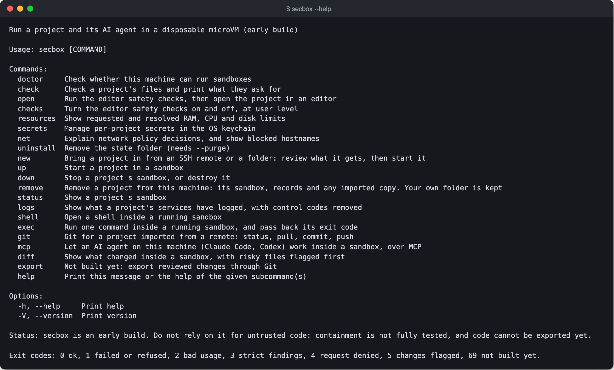

### secbox doctor: what this machine can run

`secbox doctor`

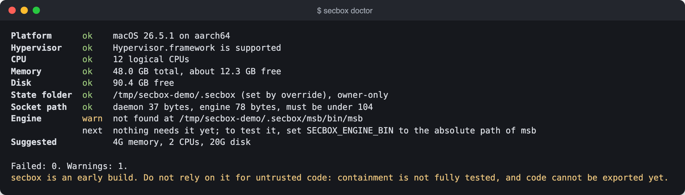

## Checking a project

### secbox check on a risky Compose project

`secbox check tests/fixtures/risky`

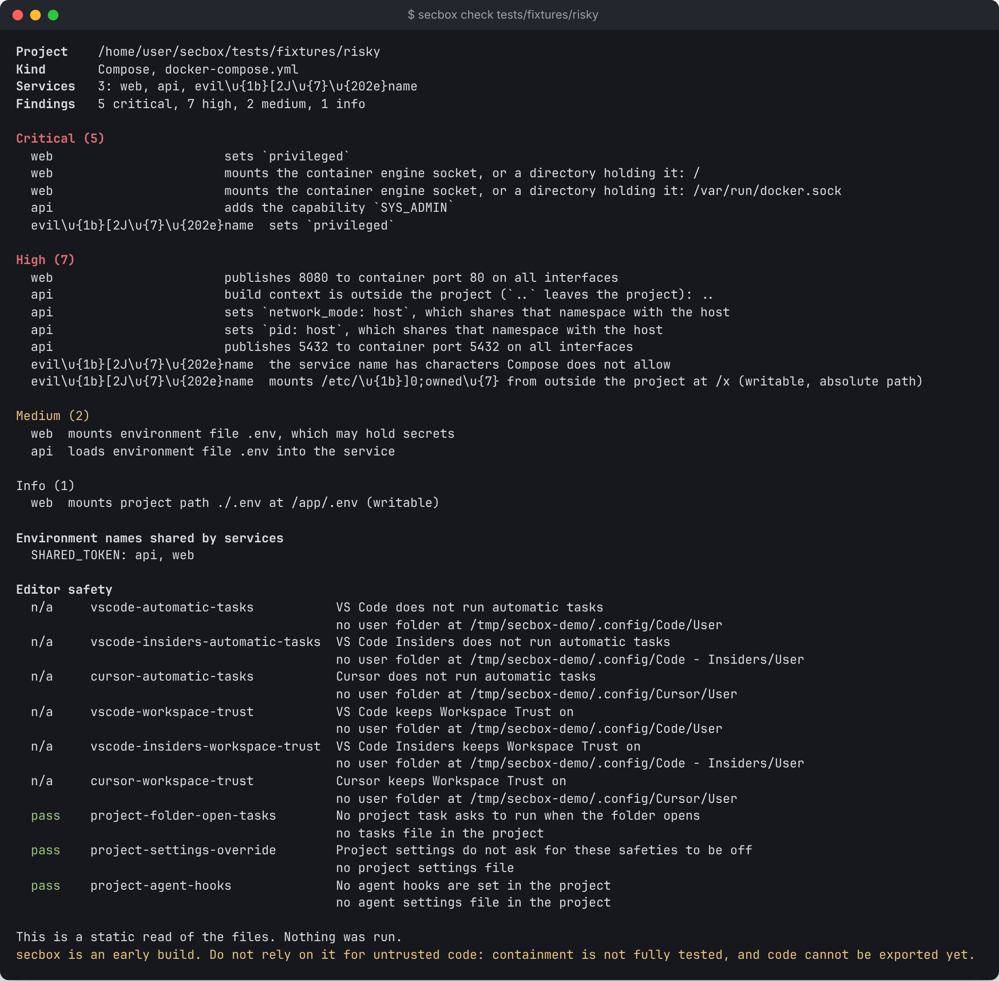

### secbox check on a clean project

`secbox check tests/fixtures/clean`

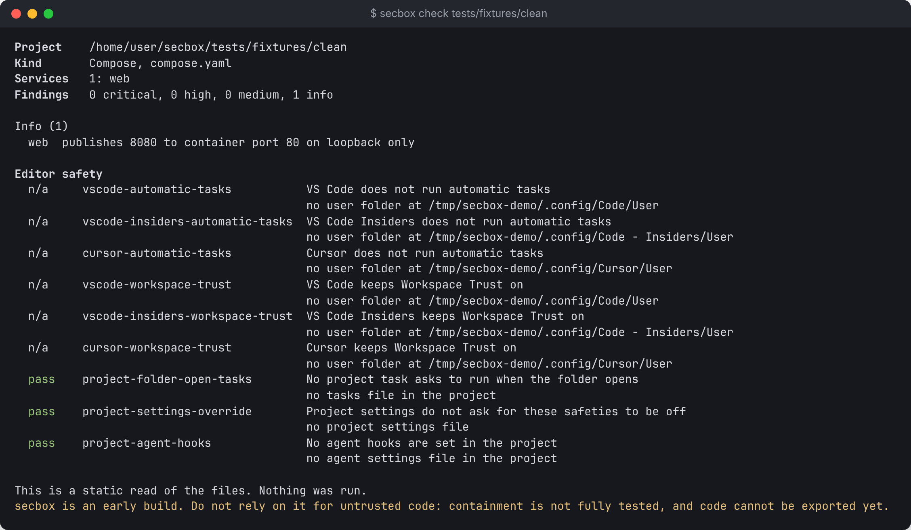

### secbox resources: a request for 999T is lowered

`secbox resources tests/fixtures/risky`

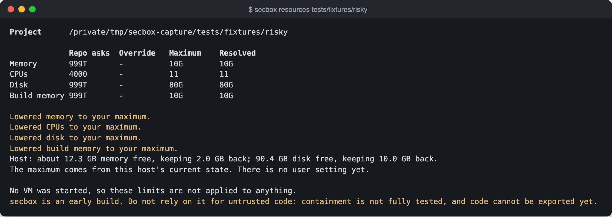

## Running a project

### secbox up --plan-only: the plan, before anything starts

`secbox up --plan-only tests/fixtures/clean`

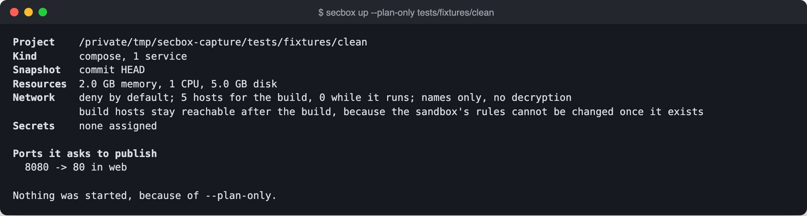

### secbox up --plan-only on a project with only a Dockerfile

`secbox up --plan-only tests/fixtures/dockerfile-only`

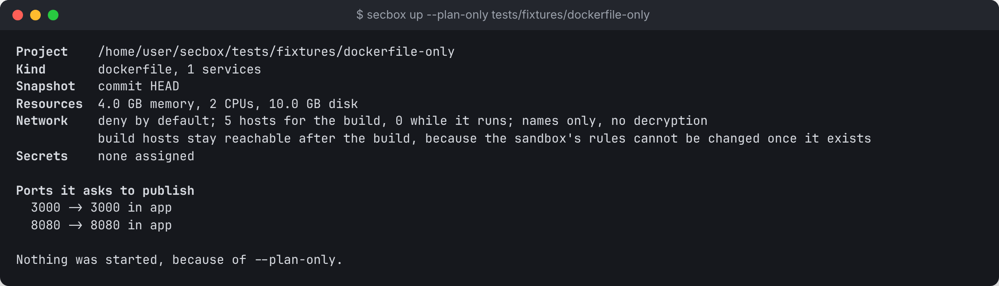

## Secrets

### secbox secrets import --dry-run: names only, never values

`secbox secrets import --dry-run tests/fixtures/fake.env --project tests/fixtures/clean`

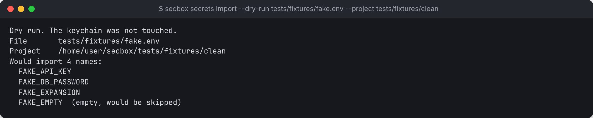

### secbox secrets list

`secbox secrets list --project tests/fixtures/clean`

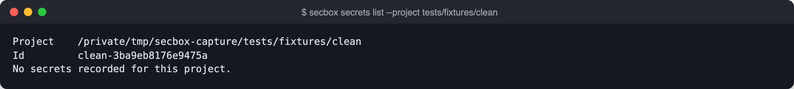

## Network

### secbox net check: an allowed request

`secbox net check tests/fixtures/policy.yaml GET https://registry.npmjs.org/left-pad`

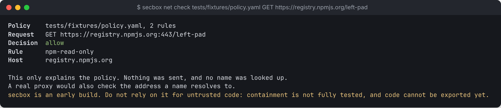

### secbox net check: publishing to npm is denied

`secbox net check tests/fixtures/policy.yaml PUT https://registry.npmjs.org/left-pad`

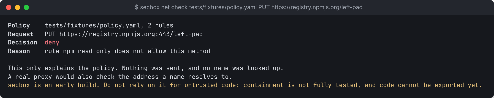

## Editors

### secbox checks list: the editor safety checks

`secbox checks list`

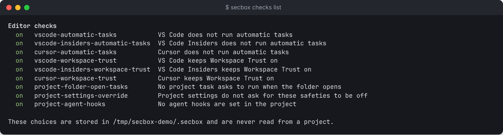

## AI agents

### secbox mcp setup codex

`secbox mcp setup codex --project tests/fixtures/clean`

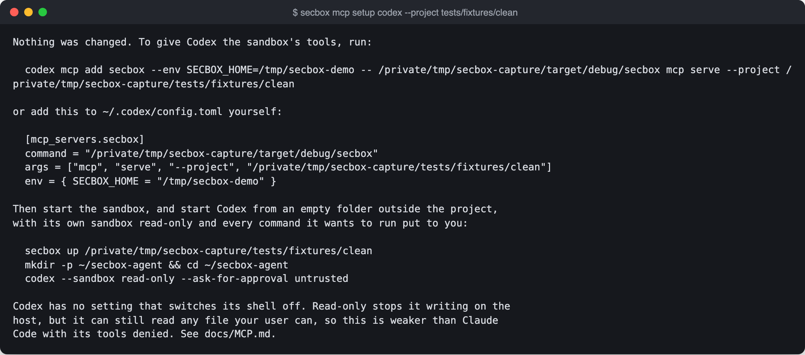

## Other

### secbox uninstall, without --purge: nothing is removed

`secbox uninstall`

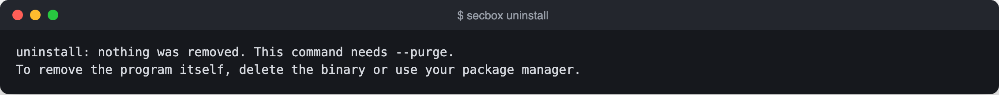

### A command that is not built yet

`secbox export`

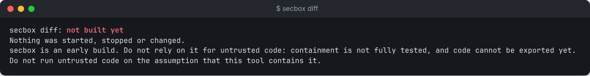

## Full-screen interface

### The full-screen interface: Overview

`secbox`

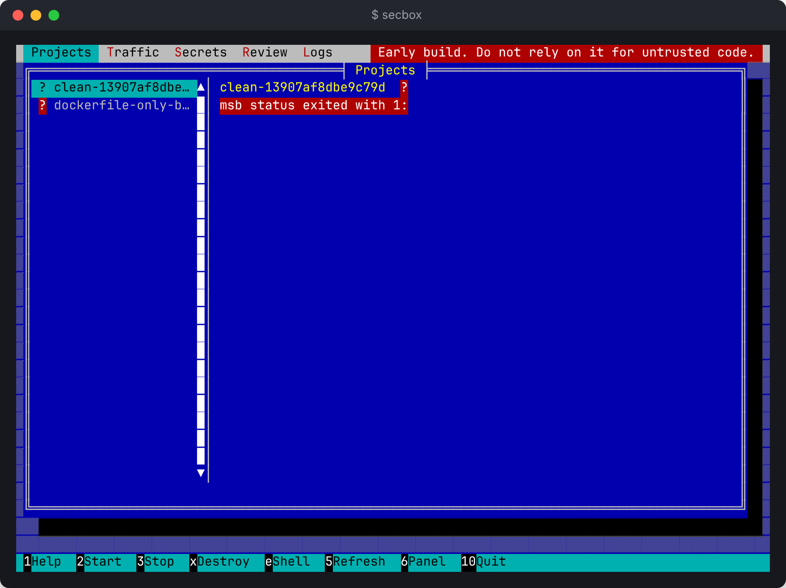

### The full-screen interface: Secrets

`secbox`

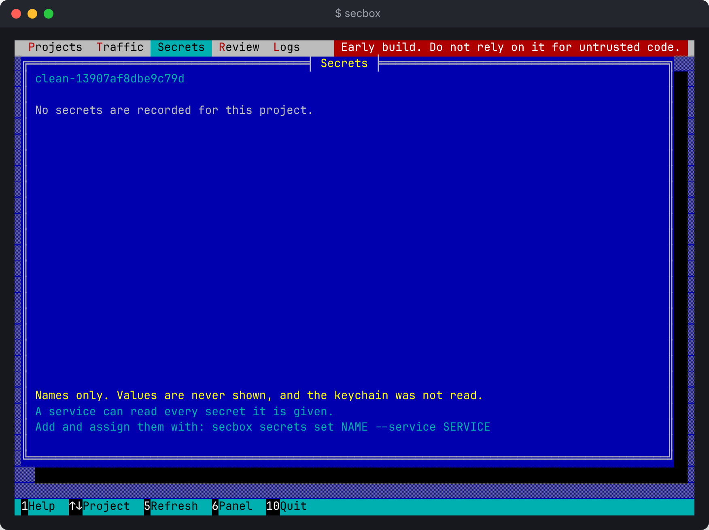

### The full-screen interface: Network

`secbox`

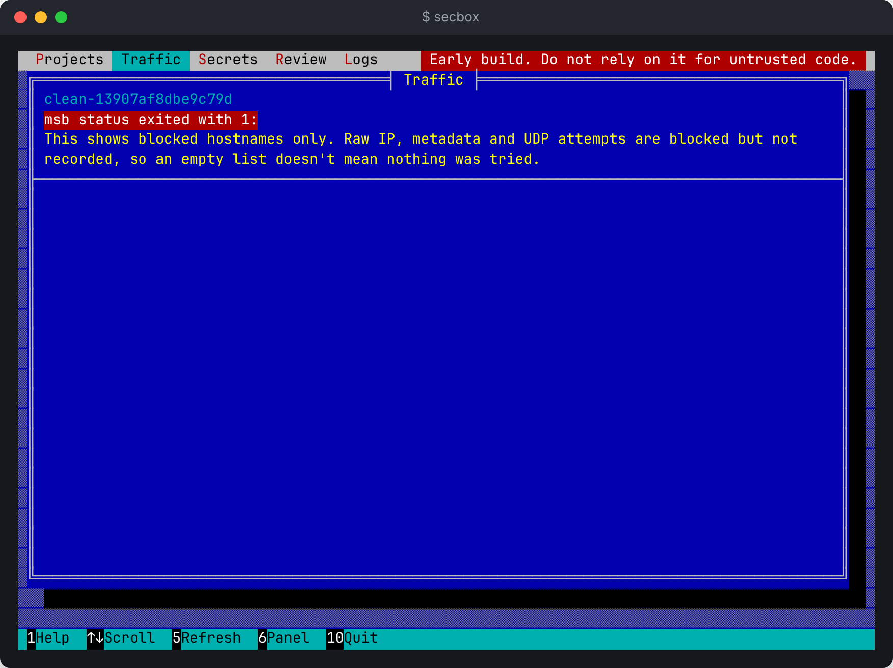

### The full-screen interface: Changes, before comparing

`secbox`

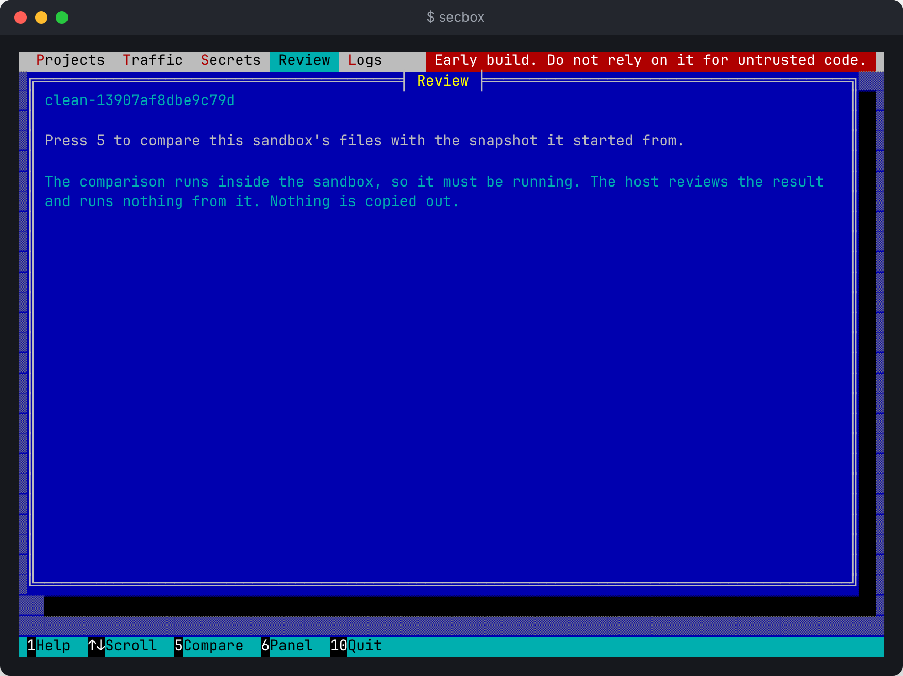
