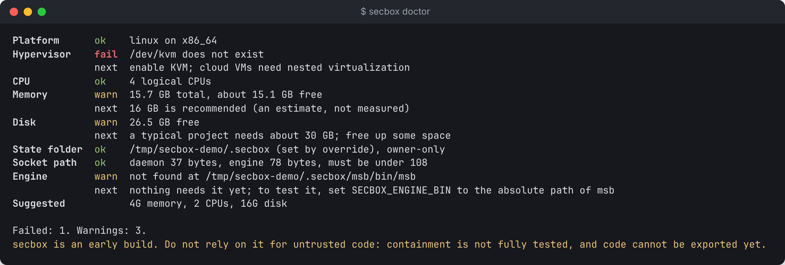
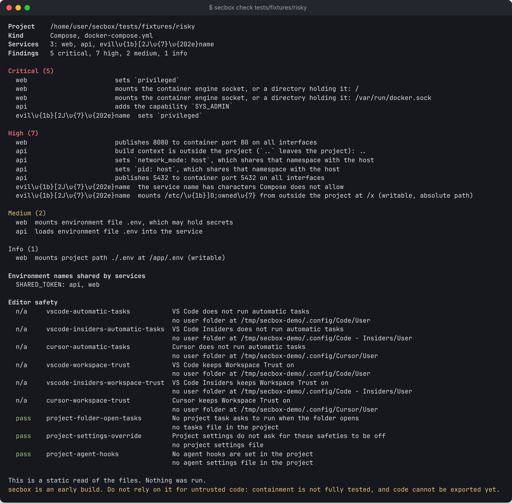
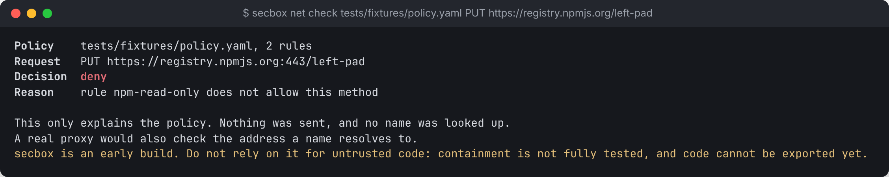
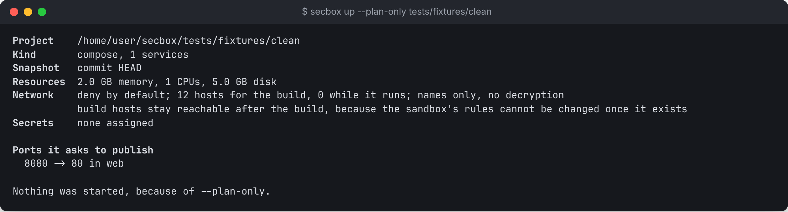

# Quick start

This page walks through secbox in two parts. The first part needs no VM and works on any machine. The second starts a real project in a sandbox.

## Part 1: no VM needed

Run these from the secbox repository folder, which ships with test projects in `tests/fixtures`.

### Check the host

```sh
secbox doctor
```



This was captured on a Linux machine without KVM, so the hypervisor line fails. On a Mac with Apple Silicon it says `ok`.

### Check a risky project

```sh
secbox check tests/fixtures/risky
```

`check` reads the project's Compose file as data and runs nothing. It lists what the project asks for: services, published ports, host folders, privileges and editor settings. It groups problems as Critical, High, Medium and Info. The risky fixture has a service with a hostile name full of terminal control codes. secbox shows those codes as visible text, such as `\u{1b}[2J`, so they cannot clear or change your terminal.



Compare a clean one:

```sh
secbox check tests/fixtures/clean
```

### See how resource limits resolve

```sh
secbox resources tests/fixtures/risky
```

The risky project asks for `999T` of memory. A project's request is never more than a request, so secbox lowers it to what your machine can spare.

### Ask a network policy a question

```sh
secbox net check tests/fixtures/policy.yaml GET https://registry.npmjs.org/left-pad
secbox net check tests/fixtures/policy.yaml PUT https://registry.npmjs.org/left-pad
```



The first is allowed. The second is denied with `rule npm-read-only does not allow this method`: this policy lets a project download npm packages but not publish them. `net check` only explains the decision. It sends nothing.

## Part 2: start a project

You need a Mac with Apple Silicon or Linux with KVM, the daemon and the engine. See [Install](install.md).

Start the daemon in one terminal:

```sh
secboxd
```

In another, go to a project that is a Git repository with a Compose file or a `Dockerfile` at its root, with at least one commit:

```sh
cd ~/code/myapp
secbox up
```

`up` asks the daemon for a **plan** and prints it: which commit will be copied in, the services, the ports it wants, the hosts it may reach, which secrets go to which service, the resource limits and any findings. If something blocks the start, it says what and stops.



It then asks:

```text
Forward 3000, 8080 to 127.0.0.1? Anything on this machine could then reach them. [y/N]
```

Answer `y` to forward them, or anything else to forward none. When it finishes, it prints each service's state and a `Ready` line such as `http://127.0.0.1:3000` for each forwarded port.

Now look inside:

```sh
secbox status           # is it running, which services, which ports
secbox logs -f          # follow every service's log; Ctrl-C stops following
secbox shell            # a shell inside the VM, in /work
secbox exec -- ls -la   # one command, with its exit code passed back
```

When you are done:

```sh
secbox down             # stop it, keeping its data for next time
secbox down --destroy   # delete the VM and everything in it
```

> Changes you make inside the sandbox stay there. There is no way to bring them back to your machine yet, and `down --destroy` deletes them.

## What next

- [Secrets](../guides/secrets.md): give one service an API key without putting it in a file.
- [AI agents over MCP](../guides/ai-agents.md): let Claude Code work in the sandbox with its own host tools switched off.
- [Full-screen terminal interface](../guides/terminal-ui.md): run `secbox` with no arguments.
